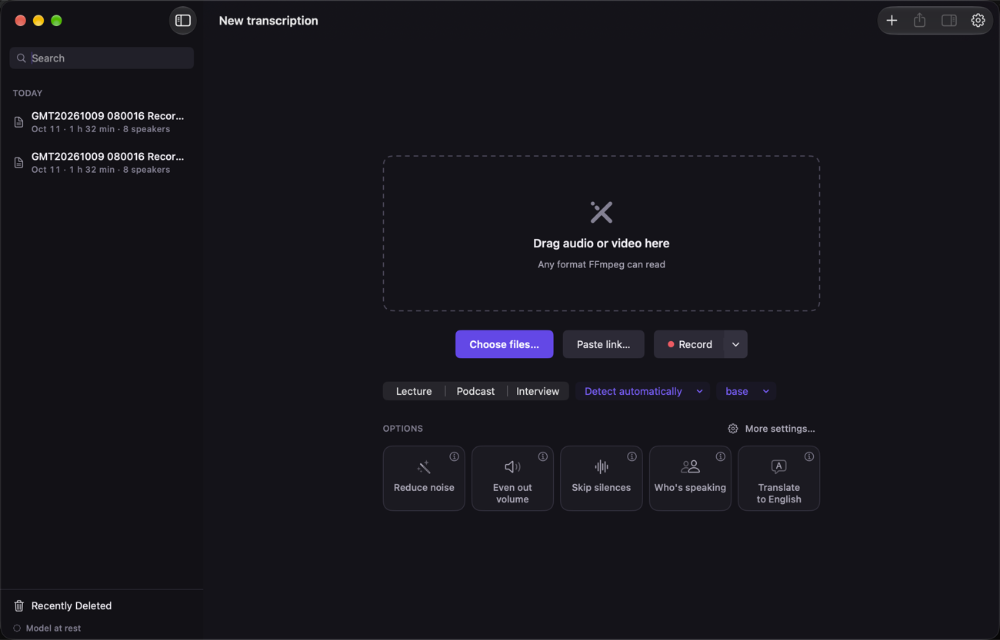
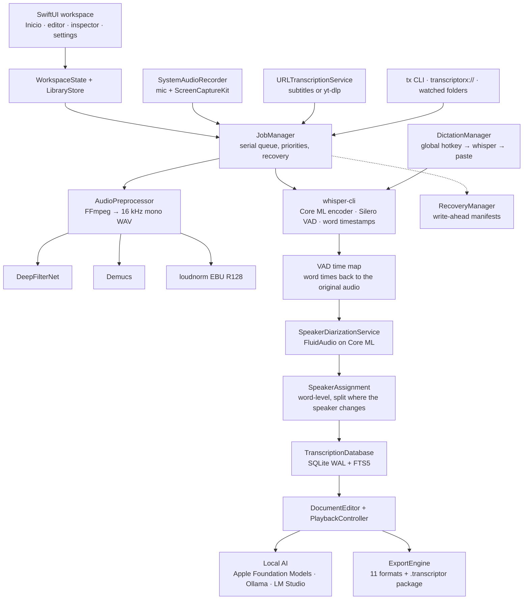

# Transcriptor X

### Private, studio-grade transcription for the Mac. Every word, every speaker, and not a single byte leaves your computer.

<p align="center">
  
  
  
  
  
  
</p>

<p align="center">
  
</p>

Transcriptor X turns meetings, lectures, interviews, podcasts and videos into clean, searchable, speaker-labelled text, and lets you dictate into any app with a single key. It is a native SwiftUI app that runs the whole pipeline on your Mac: neural noise removal, Whisper speech recognition accelerated by the Neural Engine, speaker identification, local AI summaries and translation, an editor that follows the audio word by word, and export to eleven formats. No accounts, no cloud, no telemetry.

---

## Contents

- [Why it stands out](#why-it-stands-out)
- [Everything it does](#everything-it-does)
- [Dictation anywhere](#dictation-anywhere)
- [Who said what, measured](#who-said-what-measured)
- [Under the hood](#under-the-hood)
- [Engineering highlights](#engineering-highlights)
- [Models](#models)
- [Install](#install)
- [Keyboard shortcuts](#keyboard-shortcuts)
- [Privacy](#privacy)
- [Your data on disk](#your-data-on-disk)
- [Tech stack](#tech-stack)
- [License](#license)

---

## Why it stands out

- **Truly local.** Whisper, the speaker models, noise removal, summaries and translation all run on your Mac. Your recordings are never uploaded anywhere.
- **Knows who is talking.** On-device speaker identification with a pyannote-style pipeline, assigned word by word, so a question and its answer inside the same sentence get two different speakers.
- **Built to be used every day.** Drop a file, paste a link or press Grabar. The options are plain-language tiles with a one-line explanation each, and the same settings live in Inicio and in Settings, always in sync.
- **Dictate into any app.** Hold a shortcut, speak, release, and the text appears where your cursor is, with a calm animated capsule that shows your voice.
- **An editor that listens with you.** Words light up as the audio plays. Click any word to jump there. Split, merge, favourite, find and replace, fix the timing.
- **Never loses work.** A serial job queue with write-ahead recovery: if the Mac shuts down mid-recording or mid-transcription, it picks up where it left off.
- **Feels like a Mac app.** Menu bar presence, an optional Dock-free mode, native menus and shortcuts, VoiceOver support, Reduce Motion respected, and full Spanish and English localisation.

---

## Everything it does

### Bring in anything

| | |
|---|---|
| **Files** | Any audio or video FFmpeg can read: `.mp3`, `.m4a`, `.wav`, `.flac`, `.mp4`, `.mov` and many more. Drag several at once, reorder them, and they queue up. |
| **Links** | Paste a YouTube (or other supported) URL. Published subtitles are used instantly when they exist; otherwise the audio is downloaded with `yt-dlp` and transcribed locally, with byte-level progress and clear, specific errors. |
| **Recording** | Microphone or the Mac's own audio (Zoom, Teams, a video) through ScreenCaptureKit, with pause and resume, a floating recording panel and live level meters. |
| **Meetings** | Notices when Zoom, Teams, Discord, FaceTime or a Slack huddle opens and offers to record. It can name the recording after the calendar event that is on. |
| **Watched folders** | Point it at a folder and new recordings are transcribed automatically, with optional automatic export. |

### Clean audio first

Each option is a tile on the home screen, with an ⓘ that explains it in one sentence:

- **Reduce noise.** DeepFilterNet for fans, traffic and echo, or Demucs to separate voices from music.
- **Even out volume.** EBU R128 loudness normalisation, so quiet speakers come through.
- **Skip silences.** Silero voice activity detection: faster, and no invented sentences in the gaps.
- **Who's speaking.** On-device speaker identification.
- **Translate to English.** Whisper writes the transcript straight in English.

Presets for **Lecture**, **Podcast** and **Interview** set the model and options in one click. The language is detected automatically by default.

### Edit like a pro

- Word-level timestamps: the current word is highlighted as the audio plays, and the view follows playback.
- Click to seek, play or pause from the keyboard, skip 5 seconds back or forward, change speed.
- Split at the cursor, merge segments, undo edits, restore the original text of a segment.
- Favourites with next/previous navigation, a "favourites only" view, find and replace across the document.
- Adjust timings, rename speakers and give each one a colour.

### Understand it with local AI

An inspector next to the document brings:

- **Speakers.** Who spoke and for how long, with names you choose.
- **AI.** A suggested title, a summary, tags, and a chat with your transcript. Runs on Apple Foundation Models, Ollama or LM Studio, always on your Mac or your local network.
- **Translation.** Three engines: Apple's on-device Translation framework, Whisper, or your local language model.
- **Details.** Duration, model, language, options used and file information.

### Find it later

A history with full-text search across every transcript (SQLite FTS5), grouped by date, with a "Recently Deleted" bin that keeps documents for the period you choose.

### Take it anywhere

Eleven export formats from one shared document model: **Text**, **Markdown**, **Word**, **Web (HTML)**, **PDF**, **SubRip (SRT)**, **WebVTT**, **CSV**, **JSON**, **Avid (CMX3600 EDL)** for editors, and the **`.transcriptor` project** package that keeps text, audio and edits together and reopens with a double click. Each format has its own options: speakers, timestamps, grouping, milliseconds, favourites only and more.

### Automate it

- **`tx` command-line tool:** `tx transcribe meeting.m4a --format srt --language es`, running through the app's own queue.
- **`transcriptorx://` URL scheme** to open the app or transcribe a link from scripts and Shortcuts.
- **On-screen captions** that follow a recording live.
- **Self-hosted updates** with Sparkle and a signed appcast. No telemetry.

### Always one click away

- A menu bar item with recording, queue, dictation and "copy last dictation".
- **Hide from Dock** so Transcriptor X lives only in the menu bar.
- Keep it running in the background when the window closes, so dictation, recordings and the queue stay available.
- Settings is one click away from the toolbar.

---

## Dictation anywhere

Inspired by the open-source [Handy](https://github.com/cjpais/Handy) and rebuilt in Transcriptor X's style.

- **One shortcut, three ways to use it.** *Automatic*: hold to talk and release to paste, or tap to start and tap again to paste. *Hold*: dictate only while the key is down. *Press*: one press to start, one to finish. Record any combination, with conflicts detected.
- **Esc cancels**, while you speak and even while it transcribes.
- **A capsule that shows your voice.** A pulsing dot, nine bars that follow your level, and a ✕. It widens into a spinner while Whisper works, and shows at the bottom, at the top, or not at all.
- **It pastes and puts things back.** The text is pasted with ⌘V and your clipboard is restored afterwards. It can also type character by character for fields that block pasting, or just copy. Optionally it presses Return or ⌘Return for you in chats.
- **Clean text.** Removes filler words such as "uh", "um", "eh" and "mmm", collapses stutters, strips `[BLANK_AUDIO]`, and can add a trailing space so you can keep dictating.
- **Yours to tune.** Pick a microphone, a model and a language just for dictation, a list of words it should spell right (names, brands, jargon), start and stop sounds with volume, and muting the speakers while you talk.
- **Private by design.** Dictations are not saved in the history.

---

## Who said what, measured

Speaker identification uses [FluidAudio](https://github.com/FluidInference/FluidAudio)'s offline pipeline (pyannote community-1 segmentation, WeSpeaker embeddings, VBx clustering) on Core ML, then assigns a speaker to every word.

It was validated on a real 92-minute Zoom meeting with eight people, scored against Zoom's own per-participant transcript. A reproducible harness in [`Tools/DiarizationBench`](Tools/DiarizationBench) runs FluidAudio and [speakrs](https://github.com/avencera/speakrs) on the same audio:

| Engine | Speakers found | Speaker confusion | Time for 92 min | Peak memory |
|---|---:|---:|---:|---:|
| **FluidAudio (shipping)** | 8 of 8 | 0.1% | 18 s | 1.0 GB |
| FluidAudio, high precision | 8 of 8 | 0.1% | 34 s | 1.2 GB |
| speakrs Core ML | 8 of 8 | 0.1% | 15 s | 3.2 GB |

On that meeting, **99.8% of the 13,524 transcript words carry the right speaker.**

---

## Under the hood



**What happens when you press Transcribe:**

1. The file joins a serial queue. You can reorder it or put it first with ⌥. A manifest is written so the job survives a crash.
2. FFmpeg converts it to 16 kHz mono. Noise removal, voice isolation and loudness normalisation run if you chose them.
3. `whisper-cli` transcribes with the Core ML encoder on the Neural Engine, streaming segments to the screen as they arrive, with token-level timestamps.
4. If silences were skipped, the word timestamps are mapped back onto the original audio with the same piecewise-linear map Whisper uses for segments.
5. FluidAudio finds the speakers and every word gets the speaker that overlaps it most; segments split where the speaker changes.
6. The document is stored in SQLite and indexed for search, and the editor opens it with the audio ready to play.

---

## Engineering highlights

- **Word-accurate speakers.** Whisper's VAD mode returns segment times on the original timeline but token times on the trimmed one. Rebuilding Whisper's own time map from its log fixed speaker attribution from 47% to 99.8% of words on the benchmark meeting, and keeps playback highlighting exact.
- **Measured, not guessed.** Engine choices are backed by a benchmark harness (Swift plus Rust) with DER, JER, purity and coverage scoring against a real reference, and a word-level assignment evaluator.
- **Crash-safe queue.** Write-ahead manifests for recordings and jobs; interrupted work comes back as recoverable rows on the next launch.
- **Fast, durable library.** SQLite in WAL mode with a contentless FTS5 index for instant search across hours of text.
- **One source of truth for settings.** Inicio's quick settings and Settings › Language read and write the same defaults, live in both directions.
- **Permissions that survive updates.** Builds are signed with a stable identity, so macOS keeps Microphone, Accessibility and Screen Recording access from one version to the next. Hardened runtime with exactly the entitlements it needs.
- **Native to the core.** Non-activating panels for the dictation capsule and recording panel, Carbon hotkeys with press and release for hold-to-talk, CoreAudio output muting, clipboard snapshot and restore, a Unix-socket server for the CLI.
- **Accessible.** VoiceOver labels and announcements throughout, Reduce Motion and Reduce Transparency honoured, every animation interruptible and under 300 ms where it is part of a task.
- **Tested.** Unit tests cover editor operations, formatting, speaker assignment, the VAD time map, dictation text clean-up and shortcuts.

---

## Models

Whisper models are downloaded on demand and can be managed from Settings › Models. Core ML encoders run on the Neural Engine where available.

| Model | Size | Best for |
|---|---:|---|
| `tiny` | 75 MB | Quick tests and the fastest dictation |
| `base` | 142 MB | Notes and everyday dictation |
| `small` | 466 MB | Interviews and lectures |
| `medium` | 1.5 GB | Professional transcripts |
| `large-v3-turbo` | 1.6 GB | Near top accuracy at high speed |
| `large-v2` | 2.9 GB | Recordings prone to repetitions |
| `large-v3` | 2.9 GB | Maximum multilingual accuracy |

Speaker models (FluidAudio Core ML, CC-BY-4.0) download the first time you identify speakers.

---

## Install

**Requirements:** macOS 14 Sonoma or later. Apple Silicon recommended for Neural Engine acceleration.

### Download

Get **`TranscriptorX-4.0.2.dmg`** from [Releases](https://github.com/alexbernaldo/TranscriptorX/releases/latest), open it and drag Transcriptor X to Applications. The app is not notarised, so the first time macOS asks: right-click the app › **Open** › **Open**. After that it updates itself through the app menu.

On first launch a short setup installs what it needs (FFmpeg and whisper.cpp with Core ML) and shows the progress.

### Build from source

```bash
git clone https://github.com/alexbernaldo/TranscriptorX.git
cd TranscriptorX
bash scripts/fetch_binaries.sh          # DeepFilterNet and Demucs into TranscriptorNative/AudioEngine/lib

xcodebuild -project TranscriptorNative.xcodeproj \
  -scheme TranscriptorNative -configuration Release \
  -destination 'platform=macOS' -derivedDataPath ./DerivedData-CI build
```

Builds are signed with a local identity named `Transcriptor X Code Signing`. Create your own self-signed code-signing certificate with that name, or change `CODE_SIGN_IDENTITY` in the project to `-` for ad-hoc signing.

Package the drag-to-Applications disk image (localised background, Finder layout):

```bash
python3 scripts/build_dmg.py --app "DerivedData-CI/Build/Products/Release/Transcriptor X.app"
```

Install the command-line tool with `scripts/install_cli.sh`.

---

## Keyboard shortcuts

| Shortcut | Action |
|---|---|
| ⌘N | New transcription |
| ⌘O | Open audio or video |
| ⇧⌘L | Transcribe from a link |
| ⌘. | Stop recording |
| ⌃⌥Space | Dictate (configurable) |
| ⇧⌘E | Export |
| ⇧⌘S | Save as project |
| ⇧⌘C | Copy transcript |
| ⌘F / ⌥⌘F | Find / find and replace |
| ⇧⌘F | Search the history |
| ⌥⌘P | Play or pause |
| ⌥⌘← / ⌥⌘→ | Back / forward 5 seconds |
| ⌘L | Back to the playback position |
| ⌥↩ | Split at the cursor |
| ⌘D | Mark as favourite |
| ⇧⌘T | Adjust timings |
| ⌥⌘I | Show or hide the inspector |
| ⌘, | Settings |
| ⌘U | Check for updates |

---

## Privacy

- Everything is processed on your Mac. The only network traffic is what you start yourself (model downloads, links you paste, first-time setup), plus a weekly check of a plain `appcast.xml` for updates.
- No accounts, analytics, telemetry or ads.
- Permissions are used only for what they say: Microphone for recording and dictation, Screen Recording for the Mac's own audio, Accessibility only to paste dictated text, and Calendar only to name meeting recordings.
- Dictations are never stored in the history.

---

## Your data on disk

```
~/Library/Application Support/
├── Transcriptor/
│   ├── whisper.cpp/       engine, Whisper models, Core ML encoders, Silero VAD
│   ├── diarization/       speaker models (Core ML)
│   ├── Manifests/         write-ahead manifests for in-flight work
│   ├── Recovered/         audio and text recovered after a crash
│   ├── TempRecordings/    recordings in progress
│   └── Logs/              structured logs, exportable from the Help menu
└── TranscriptorNative/
    ├── transcriptions.sqlite   history and full-text index
    └── audio/                  audio kept with each transcript
```

---

## Tech stack

| Layer | Technology |
|---|---|
| App | Swift, SwiftUI, AppKit, Combine |
| Speech recognition | whisper.cpp with Core ML encoders, Silero VAD |
| Speakers | FluidAudio (pyannote community-1, WeSpeaker, VBx) on Core ML |
| Audio | FFmpeg, DeepFilterNet, Demucs, AVFoundation, ScreenCaptureKit, CoreAudio |
| Local AI | Apple Foundation Models, Apple Translation, Ollama, LM Studio |
| Storage | SQLite (WAL, FTS5) |
| Links | yt-dlp, youtube-transcript-api |
| Updates | Sparkle 2 with EdDSA-signed appcast |
| Tooling | XCTest, Swift Package Manager, a Rust and Python benchmark harness |

---

## License

Transcriptor X is released under the **PolyForm Noncommercial 1.0.0** license: use and modify it freely for non-commercial purposes. See [`LICENSE`](LICENSE).

Third-party components (whisper.cpp, FluidAudio and its models, DeepFilterNet, Demucs, PyTorch, FFmpeg, yt-dlp, youtube-transcript-api, Sparkle and others) and their licenses are listed in [`THIRD_PARTY_NOTICES.md`](THIRD_PARTY_NOTICES.md) and [`licenses/`](licenses/).
