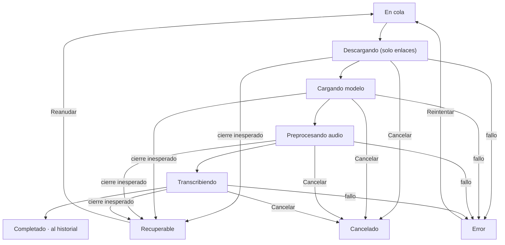

# Transcriptor X · Especificación de diseño

Oct 10, 2026 · @Alejandro Bernaldo de Quirós Gómez

## 1. Dirección creativa y decisiones principales

Transcriptor X se presenta como una mesa de trabajo oscura y silenciosa en la que el morado eléctrico señala solo lo que está vivo: la palabra que suena, el elemento seleccionado, la acción principal y la marca. Todo lo demás es gris, texto y espacio.

**Concepto: «De la señal a la línea».** El sonido entra fragmentado y sale convertido en una línea continua de texto. El símbolo, la animación de apertura, el indicador de dictado y la cápsula de subtítulos repiten esa idea: fragmentos que se ordenan hasta formar una línea.

**Reglas globales** (valen para todas las pantallas y no se repiten después):

1. El morado es estado. En reposo ocupa menos del 5 % de la superficie de la ventana: botón principal, anillo de foco, selección y símbolo. Nunca rellena fondos grandes ni forma gradientes.
2. El texto es la interfaz. La transcripción ocupa una columna de 680 pt como máximo, a 15/24 pt. Los controles retroceden a 13 pt y a grises.
3. Una ventana, tres regiones: Historial a la izquierda, área de trabajo en el centro e inspector a la derecha solo cuando se pide. Las tareas puntuales usan sheets; lo que ocurre fuera de la ventana usa paneles flotantes que no roban el foco.
4. Lo técnico se traduce a consecuencias. El usuario ve «Recuperar trabajos», no WAL; «Modelo en reposo», no descarga de memoria; «Acelerado por Neural Engine» aparece solo en la gestión de modelos.
5. El movimiento explica causa y destino. Algo se desplaza si viene de un sitio o va a otro; si no, aparece con un fundido de 120 ms o sin animación.
6. La privacidad se demuestra con hechos en un solo lugar (Ajustes › Privacidad y una línea del asistente inicial), sin sellos ni avisos repetidos.

**Decisiones principales**

| Tema | Decisión | Motivo |
| --- | --- | --- |
| Estructura | Barra lateral (Historial), área de trabajo e inspector plegable | Patrón nativo (NavigationSplitView + inspector); absorbe 36 funciones sin saturar |
| Historial y cola | Una sola lista: sección «En proceso» sobre el historial agrupado por fechas | Un trabajo es el mismo objeto antes y después de terminar; no hay listas duplicadas |
| Nueva transcripción | Lienzo en el área central, no ventana aparte | Es el estado de inicio y el destino del botón Nueva |
| Grabación | Popover desde la barra de herramientas y panel flotante durante la captura | La grabación continúa aunque el usuario cambie de aplicación |
| Exportación | Sheet con formatos a la izquierda y opciones del formato elegido a la derecha | Nunca se ven opciones incompatibles |
| IA, traducción, hablantes | Pestañas del inspector junto al documento | Se consultan mientras se lee y se edita |
| Ajustes | Ventana de Ajustes con barra lateral, estilo Ajustes del Sistema | Once secciones no caben en pestañas de barra de herramientas |
| Apariencia | Oscura por defecto; opción Sistema, Oscura o Clara | La identidad se define en oscuro; la clara es una traducción, no otra marca |

Los supuestos funcionales que condicionan el diseño se listan en la sección 12.

## 2. Identidad: logo, logotipo e iconos

El símbolo es una X formada por dos trazos: uno continuo y otro que empieza fragmentado y se vuelve continuo justo en el cruce. La X no es una letra decorativa: es el punto exacto donde el audio se convierte en texto.

### 2.1 Construcción del símbolo «Cruce»

Retícula de 32 × 32 unidades. Trazo de 4 unidades, remates redondos, sin relleno. Coordenadas en unidades sobre la línea central del trazo:

| Elemento | Representa | Geometría |
| --- | --- | --- |
| Trazo A (continuo) | El texto resultante | Segmento de (7, 25) a (25, 7) |
| Trazo B, fragmento 1 | Muestra de audio | Punto en (7, 7): círculo de Ø 4 |
| Trazo B, fragmento 2 | Muestra de audio | Segmento de (11, 11) a (12, 12) |
| Trazo B, tramo continuo | La señal ya convertida | Segmento de (16, 16) a (25, 25) |

- El tramo continuo de B nace exactamente en el centro (16, 16), donde cruza A. El cruce es la transformación.
- Espacio negativo entre fragmentos: 1,66 unidades de hueco libre medido sobre la diagonal, constante. El ojo lee ritmo, no puntos sueltos.
- Caja óptica: el símbolo ocupa de 5 a 27 en ambos ejes (22 unidades); el margen interior de 5 unidades queda dentro de la retícula para que el símbolo se centre ópticamente en cualquier contenedor.
- Ángulo único: 45°. No hay curvas salvo los remates.

**Color del símbolo sobre oscuro:** trazo A en Texto principal `#EDEBF2`; fragmentos de B en Morado 300 `#B9A9FF` al 70 %; tramo continuo de B en Morado X `#7C5CFF`. Sobre claro: A en `#1A1820`, fragmentos en `#6847EF` al 55 %, tramo continuo en `#6847EF`.

**Versión monocroma:** todo en un solo color al 100 %. Los fragmentos mantienen su forma; la diferencia entre fragmento y línea la da la geometría, no el color.

**Versión reducida (≤ 24 px de altura):** se elimina el punto (7, 7); queda un fragmento (11, 11)–(12, 12) y el tramo continuo. Por debajo de 16 px, el trazo sube a 4,5 unidades para no perder peso.

### 2.2 Logotipo

- Composición horizontal: símbolo + nombre «Transcriptor X». Altura del símbolo = 1,3 × altura de mayúscula del texto. Separación símbolo-texto = 0,4 × altura del símbolo. Alineación: centro vertical del símbolo con la mitad de la altura de mayúscula.
- Tipografía de marca: Inter Display SemiBold (licencia OFL), tracking −1 %. No se usa SF Pro en el logotipo porque su licencia limita el uso a interfaces de plataformas Apple; dentro de la app la tipografía sí es SF Pro.
- La «X» del nombre va en el mismo peso y color que el resto. El símbolo ya carga el morado; repetirlo en la letra resta.
- Versión compacta: solo el símbolo. Se usa en Dock, barra de menús, Acerca de y animación de apertura.
- Fondos: oscuro (colores de 2.1), claro (colores claros de 2.1), monocromo blanco o negro para impresión y relieves.

**Área de protección:** 0,25 × altura del símbolo en los cuatro lados, tanto en el símbolo solo como en el logotipo.

**Usos incorrectos:** rotar el símbolo (deja de leerse la dirección de la señal); invertir qué trazo está fragmentado; añadir fragmentos al trazo A; usar el morado en el trazo A; aplicar sombras, brillos o neón; poner el símbolo sobre fotografía; estirar o cambiar el grosor fuera de la regla de tamaños pequeños; encerrar el símbolo en un círculo.

### 2.3 Icono de aplicación (Dock)

- Lienzo de 1024 × 1024 px, cuerpo de 824 × 824 px en (100, 100) con el radio de la plantilla de iconos de macOS.
- Fondo: gris muy oscuro con un único degradado vertical sutil, `#1E1B27` arriba a `#121116` abajo. Es el único degradado de toda la identidad.
- Borde interior de 2 px a `rgba(255,255,255,0.08)` solo en el tercio superior, para separar el icono del Dock oscuro.
- Símbolo a 512 × 512 px centrado (1 unidad = 16 px, trazo de 64 px), colores de 2.1 sobre oscuro.
- macOS 26 (Icon Composer): tres capas separadas para que el sistema genere las variantes oscura, clara, tintada y transparente: fondo, trazo A, trazo B. En la variante tintada, B conserva más opacidad que A para que se siga leyendo la transformación.
- 16 y 32 px: versión reducida de 2.1 y fondo plano `#16141C`.

### 2.4 Símbolo de la barra de menús

- Imagen de plantilla (template) monocroma, lienzo de 18 × 18 pt, símbolo de 16 × 16 pt, trazo de 2 pt, versión reducida (un fragmento + tramo continuo). macOS la colorea según el fondo de la barra; no depende del morado.
- Estados del elemento de la barra:
  - Reposo: símbolo solo.
  - Grabando: símbolo + tiempo transcurrido en cifras tabulares, «12:04».
  - Cola activa: el tramo continuo de B se dibuja discontinuo (tres fragmentos iguales). Estático, sin parpadeo.
  - Reunión detectada: imagen no plantilla con un punto naranja `#FF8A3D` de 5 pt arriba a la derecha. Es la única excepción de color y desaparece al grabar o descartar.

### 2.5 Dónde aparece la identidad y dónde se retira

| Aparece | Se retira |
| --- | --- |
| Dock, barra de menús, ventana Acerca de | Barra de herramientas y cabecera del documento |
| Animación de apertura y bienvenida del asistente | Editor, inspector, sheets de exportación |
| Estado vacío de inicio (símbolo de 40 pt en Texto terciario) | Ajustes (salvo la sección Acerca de) |
| Overlay de dictado y cápsula de subtítulos (solo el ritmo de fragmentos como indicador de nivel) | Errores, avisos y diálogos |

## 3. Sistema de diseño

El sistema tiene un solo color de acento (`#7C5CFF`), cuatro niveles de gris con un leve matiz violeta y una tipografía de sistema. Cada token se define en oscuro (referencia) y en claro (traducción).

### 3.1 Color

El color de acento de la app (AccentColor del catálogo de recursos) es `#7C5CFF`; así el anillo de foco, los toggles y la selección nativa heredan el morado sin código extra.

**Superficies y líneas**

| Token | Oscuro | Claro | Uso |
| --- | --- | --- | --- |
| bg.window | `#141319` | `#FFFFFF` | Área de trabajo y editor |
| bg.sidebar | Material de barra lateral + `#100F14` al 88 % | `#F1EFF5` al 92 % | Historial. Con Reducir transparencia: color al 100 % |
| bg.surface | `#1B1A22` | `#F7F6FA` | Reproductor, cabeceras, campos |
| bg.elevated | `#23212C` | `#FFFFFF` + sombra | Popovers, sheets, menús propios |
| bg.control | `#2C2A37` | `#E9E7F0` | Botones secundarios, segmentados |
| bg.hover | blanco al 5 % | negro al 4 % | Hover de filas y botones sin borde |
| bg.pressed | blanco al 9 % | negro al 8 % | Pulsado |
| separator | `#2A2833` | `#E2E0E8` | Líneas de 1 px entre regiones |
| border | `#34313F` | `#D6D3DF` | Contorno de campos y contenedores |
| border.strong | `#4A4658` | `#B9B5C6` | Hover de campos |

**Texto**

| Token | Oscuro | Claro | Uso |
| --- | --- | --- | --- |
| text.primary | `#EDEBF2` | `#1A1820` | Transcripción, títulos, valores |
| text.secondary | `#A9A5B5` | `#5C5868` | Metadatos, etiquetas de controles |
| text.tertiary | `#848094` | `#6E6A7B` | Timestamps y pistas, solo sobre bg.window o bg.sidebar |
| text.disabled | `#5A5766` | `#A8A4B4` | Controles desactivados (no requiere contraste) |
| text.onAccent | `#FFFFFF` | `#FFFFFF` | Texto sobre botón principal |

**Morado**

| Token | Valor | Uso |
| --- | --- | --- |
| purple.X | `#7C5CFF` | Marca, anillo de foco, barras de progreso, nivel de audio. No se usa para texto pequeño |
| purple.300 | `#B9A9FF` | Fragmentos del símbolo, hablante 1 en claro sobre oscuro |
| purple.400 | `#9A82FF` | Texto y enlaces morados sobre oscuro, iconos activos |
| purple.600 | `#6847EF` | Relleno del botón principal; texto morado sobre claro |
| purple.600.hover | `#7452F7` | Hover del botón principal |
| purple.700 | `#5A3AD6` | Pulsado del botón principal |
| selection.row | purple.X al 22 % (≈ `#2B2347`) | Fila seleccionada con la lista enfocada; sin foco: blanco al 8 % |
| selection.text | purple.X al 40 % | Selección de texto en el editor |
| word.active | purple.X al 34 % (≈ `#372C67`) + subrayado de 2 pt `#9A82FF` | Palabra que suena |
| segment.playing | barra de 2 pt purple.X en el margen izquierdo | Segmento en reproducción |

**Semánticos** (en banners y etiquetas: relleno del color al 12 %, borde al 40 %, icono al 100 %, texto en text.primary)

| Token | Oscuro | Claro |
| --- | --- | --- |
| success | `#3FCF8E` | `#12875A` |
| warning | `#F2B441` | `#9A6400` |
| error | `#FF5D6C` | `#C62F3E` |
| info | `#5AB0FF` | `#1F6FC4` |
| record | `#FF4D5E` | `#D92B3D` |
| meeting | `#FF8A3D` | `#C25A12` |

**Banner de reunión:** relleno meeting al 12 % (≈ `#2E2019`), borde de 1 px meeting al 45 %, icono `calendar.badge.clock` en meeting. Botón «Grabar ahora» con relleno `#FF8A3D` y texto `#1A1208`. Es el único botón relleno que no es morado, porque compite en importancia con el botón principal solo mientras dura la reunión.

**Hablantes** (color + forma + nombre; nunca solo color)

| Hablante | Color | Forma |
| --- | --- | --- |
| 1 | `#9A82FF` | círculo |
| 2 | `#4FC3D9` | cuadrado |
| 3 | `#F2B441` | triángulo |
| 4 | `#FF7AA8` | rombo |
| 5 | `#7BD88F` | hexágono |
| 6 | `#D9A87C` | triángulo invertido |
| 7 o más | se repite la paleta | forma + número visible («H7») |

**Contraste a verificar.** Ratios calculados con luminancia relativa WCAG sobre los HEX; deben comprobarse sobre el render final (Accessibility Inspector de Xcode), sobre todo encima del material de la barra lateral:

| Par | Ratio aprox. | Exigencia | Resultado |
| --- | --- | --- | --- |
| text.secondary / bg.window | 7,7:1 | 4,5:1 | Cumple |
| text.tertiary / bg.window | 4,8:1 | 4,5:1 | Cumple por poco: no bajar de 11 pt |
| text.tertiary / bg.elevated | 4,2:1 | 4,5:1 | No cumple: en popovers y sheets se usa text.secondary |
| purple.400 / bg.window | 6,2:1 | 4,5:1 | Cumple |
| purple.X / bg.window | 4,3:1 | 3:1 (no texto) | Solo indicadores y gráficos |
| text.onAccent / purple.600 | 5,6:1 | 4,5:1 | Cumple |
| text.onAccent / purple.600.hover | 4,9:1 | 4,5:1 | Cumple |
| text.primary / word.active | 10,3:1 | 4,5:1 | Cumple |
| `#1A1208` / meeting | 8,1:1 | 4,5:1 | Cumple |
| text.secondary claro / `#F7F6FA` | 6,4:1 | 4,5:1 | Cumple |
| purple.600 / blanco | 5,6:1 | 4,5:1 | Cumple |

### 3.2 Tipografía

SF Pro (Text y Display, ópticos automáticos) para toda la interfaz y la transcripción; SF Mono para timestamps y datos técnicos. Cifras tabulares en todo número que cambie (tiempos, contadores, porcentajes).

| Estilo | Fuente | Tamaño / interlineado | Peso | Uso |
| --- | --- | --- | --- | --- |
| Display | SF Pro Display | 26 / 32 pt | Semibold | Títulos del asistente inicial |
| Título documento | SF Pro Display | 20 / 26 pt | Semibold | Cabecera del editor |
| Título sección | SF Pro Text | 15 / 20 pt | Semibold | Sheets, estados vacíos, secciones del inspector |
| Transcripción | SF Pro Text | 15 / 24 pt | Regular | Texto de segmentos |
| Hablante | SF Pro Text | 12 / 16 pt | Semibold | Nombre sobre el segmento |
| Interfaz | SF Pro Text | 13 / 18 pt | Regular; Medium en títulos de fila | Controles, filas, banners |
| Secundario | SF Pro Text | 12 / 16 pt | Regular | Descripciones, ayudas |
| Metadato | SF Pro Text | 11 / 14 pt | Medium, +0,2 tracking | Fechas, duración, encabezados de grupo en mayúsculas pequeñas |
| Timestamp | SF Mono | 11 / 14 pt | Medium, tabular | Tiempos de segmento, códigos de tiempo |
| Dato técnico | SF Mono | 12 / 16 pt | Regular | Rutas, comandos CLI, detalles de error |
| Subtítulo flotante | SF Pro Display | 22 / 28 pt | Semibold | Cápsula de subtítulos |

- Columna de lectura: 680 pt máximo (≈ 75 caracteres a 15 pt). En ventanas más anchas el sobrante se reparte como margen; nunca se estira la línea.
- Párrafos de segmento sin sangría; separación entre segmentos de 12 pt; entre turnos de hablante, 20 pt.
- Tamaño de texto: Ajustes › Comportamiento ofrece Pequeño (13/21), Normal (15/24), Grande (17/27), Muy grande (20/31) para la transcripción. La interfaz sigue el tamaño del sistema.

### 3.3 Geometría

| Elemento | Valor |
| --- | --- |
| Escala de espaciado | 2 · 4 · 8 · 12 · 16 · 20 · 24 · 32 · 40 · 48 pt |
| Margen interior de regiones | 16 pt (barra lateral e inspector), 32 pt (editor, horizontal) |
| Radios | 4 pt etiquetas · 6 pt controles · 8 pt filas, campos y banners · 10 pt popovers · 14 pt paneles flotantes · cápsula completa en subtítulos y dictado |
| Bordes | 1 px; 2 pt solo para foco propio, segmento en reproducción y borde de banner de reunión |
| Sombras | Popovers y paneles flotantes: 0 8 24 negro al 45 % + borde interior de 1 px blanco al 6 %. Nada más lleva sombra |
| Alturas de control | 22 pt pequeño · 28 pt normal · 36 pt grande (solo acción principal de estados vacíos y asistente) |
| Iconos | SF Symbols. 13 pt en filas y botones, 15 pt en barra de herramientas, 16 pt en barra lateral, 40 pt en estados vacíos. Peso Regular; Medium en barra de herramientas |
| Área mínima de clic | 28 × 28 pt; filas a todo el ancho |
| Densidad | Filas de historial de 52 pt, filas de cola de 56 pt, filas de ajustes de 36 pt |
| Materiales | Solo barra lateral, panel flotante de grabación, overlay de dictado y subtítulos. Siempre con capa de color al 85 % o más encima |

### 3.4 Componentes

**Estados compartidos** (todas las familias): hover = bg.hover o un paso más claro del relleno; pulsado = bg.pressed o purple.700; foco = anillo de sistema en el color de acento (3 pt, por fuera); desactivado = texto en text.disabled y relleno al 50 %, sin hover; seleccionado = selection.row. Ningún estado depende solo del color: la selección añade peso Medium al título, el foco añade el anillo, el error añade icono.

| Familia | Anatomía | Particularidades |
| --- | --- | --- |
| Botón principal | 28 pt, padding horizontal 14 pt, radio 6, relleno purple.600, texto 13 Semibold blanco | Uno por vista. Responde a Retorno |
| Botón secundario | Mismo tamaño, relleno bg.control, texto text.primary | Responde a Esc si es Cancelar |
| Botón sin borde | Texto purple.400 13 Medium, sin relleno hasta hover | Acciones terciarias y enlaces |
| Botón destructivo | Secundario con texto error | En confirmaciones, el verbo exacto: «Eliminar 3 transcripciones» |
| Botón de icono | 28 × 28 pt, icono 15 pt, tooltip obligatorio con atajo | Barra de herramientas y cabeceras |
| Botón Grabar | Secundario con punto record de 8 pt + «Grabar» y chevron de menú | Grabando: relleno record al 16 %, borde record, punto fijo y tiempo «04:12» |
| Selector (pop-up) | 28 pt, texto + chevron doble de 9 pt | Menú nativo. Opciones no compatibles aparecen desactivadas con motivo en la línea secundaria |
| Campo de texto | 28 pt, relleno bg.surface, borde 1 px border, radio 6, placeholder text.tertiary | Error: borde error + mensaje 12 pt debajo |
| Búsqueda | Campo con lupa y botón de borrar; contador «12 resultados» a la derecha en 11 pt | ⌘F en el editor (⌥⌘F con reemplazar), ⇧⌘F en el historial |
| Toggle | Interruptor nativo, activo en el color de acento | Para preferencias que se aplican al momento |
| Casilla | Casilla nativa | Para opciones de exportación y listas de opciones combinables |
| Slider | Pista de 4 pt bg.control, tramo lleno purple.X, mando de 16 pt | Valores discretos con marcas y valor visible a la derecha («2 s») |
| Menú | NSMenu nativo, nunca dibujado a medida | Atajos alineados a la derecha |
| Control segmentado | Nativo, 2 a 4 segmentos | Para cambios de vista, no para acciones |
| Fila de historial | 52 pt: icono de origen 16 pt, título 13 Medium (1 línea), metadato 11 pt «12 oct · 42 min · 3 hablantes», estrella si tiene favoritos | Seleccionada: selection.row, radio 8, inset 8 pt |
| Fila de cola | 56 pt: título, línea de estado 11 pt, barra de progreso de 3 pt bajo el texto | En hover: asa de arrastre a la izquierda y botón de cancelar a la derecha |
| Etiqueta de estado | 18 pt de alto, radio 4, 11 Medium, relleno al 14 % del color | En cola (neutro), Preparando, Transcribiendo (morado), Descargando (info), Error, Recuperable (aviso) |
| Progreso | Determinado: línea de 3 pt purple.X. Indeterminado: tramo del 30 % que recorre la pista en 1,2 s. En espera: pista discontinua estática (fragmentos de 6 pt y huecos de 4 pt) | Nunca un porcentaje si el proceso no lo da |
| Banner | En la parte superior del área de trabajo, margen 12 pt, radio 8, 44 pt en una línea, icono 15 pt, título 13 Semibold + texto 13, acciones a la derecha | Tipos: info, aviso, error, reunión, recuperación. Máximo uno visible; el resto se apila en «2 avisos más» |
| Sheet | Nativo, 520 pt (simple) o 760 pt (exportación), padding 20, título 15 Semibold, botones abajo a la derecha | Retorno = principal, Esc = cancelar |
| Popover | 320 pt, padding 16, flecha nativa, bg.elevated | Se cierra al hacer clic fuera o con Esc |
| Tooltip | Nativo, máximo 80 caracteres, atajo al final («Exportar… ⇧⌘E») | Obligatorio en botones de icono |
| Confirmación | NSAlert nativo con verbo concreto y consecuencia | Nunca «¿Estás seguro?» |
| Estado vacío | Centrado, icono 40 pt text.tertiary, título 15 Semibold, texto 13 secondary (máx. 360 pt), un botón grande | Una sola acción principal |
| Aviso breve (toast) | 36 pt, abajo al centro del área de trabajo, bg.elevated, icono + texto + acción opcional | Desaparece a los 4 s; con VoiceOver se anuncia y se mantiene 8 s |

### 3.5 Apariencia clara

La apariencia clara usa la columna «Claro» de cada tabla: mismas formas, mismo único acento y mismas reglas de uso del morado. Cambian solo los valores: el morado de texto pasa a purple.600, los semánticos a sus variantes oscuras y la barra lateral a un gris lila muy claro. El símbolo usa su versión sobre claro.

## 4. Arquitectura de información y ventana

La ventana principal tiene tres regiones fijas (Historial, área de trabajo, inspector) y una barra de herramientas con cinco controles. Todo lo demás vive en sheets, popovers, la ventana de Ajustes, el menú de barra o paneles flotantes.

### 4.1 Esquema de la ventana principal

```
┌────────────────────────────────────────────────────────────────────────────────────┐
│ ● ● ●  [≡]   Entrevista con Marta                    [● Grabar ▾] [+ ▾] [↑] [◫]     │ 52 pt
│              12 oct 2026 · 42 min                                                   │
├──────────────────┬──────────────────────────────────────────────┬──────────────────┤
│ [⌕ Buscar]        │ ┌ BANNER (reunión, recuperación, aviso) ─────┐ │ [Hablantes|IA|    │
│                   │ └────────────────────────────────────────────┘ │  Traducción|      │
│ EN PROCESO  2     │  [Barra Buscar y reemplazar, bajo demanda]     │  Detalles]        │
│  ◐ Clase_04.m4a   │                                                │                   │
│  ▭ youtube.com/…  │  Cabecera del documento                        │  Contenido de la  │
│                   │  ──────────────────────────────────────────    │  pestaña activa   │
│ HOY               │  00:01:12  ● MARTA                              │                   │
│  Entrevista Marta │            Texto del segmento…                 │                   │
│  Dictado reunión  │  00:01:31  ■ ALEJANDRO                          │                   │
│ AYER              │            Texto del segmento…                 │                   │
│  Podcast ep. 12   │      (columna de lectura, máx. 680 pt)         │                   │
│ …                 │                                                │                   │
│ ───────────────── │ ────────────────────────────────────────────── │                   │
│ ⌫ Eliminados  4   │ [▶] 00:12:04 ━━━━━━━●──────── 00:42:10  1×  ⟲ │                   │ 56 pt
│ ◌ Modelo en reposo│                                                │                   │
└──────────────────┴──────────────────────────────────────────────┴──────────────────┘
   Historial 260 pt          Área de trabajo (flexible, mín. 480 pt)    Inspector 300 pt
```

### 4.2 Regiones

| Región | Contenido | Persistencia |
| --- | --- | --- |
| Barra de herramientas (unificada, 52 pt) | Botón de barra lateral · título y subtítulo del documento (o «Nueva transcripción») · Grabar con menú de fuentes · Nueva con menú (Desde archivos…, Desde URL…) · Exportar · Inspector | Siempre. Personalizable con el menú nativo de la barra |
| Historial (barra lateral) | Búsqueda · sección «En proceso» (solo si hay trabajos) · historial agrupado por Hoy, Ayer, Últimos 7 días, mes y año · pie con «Eliminados recientemente» y estado del modelo | Siempre, plegable con ⌃⌘S |
| Área de trabajo | Una de cinco vistas: Inicio (nueva transcripción), Trabajo en proceso, Transcripción en vivo, Documento (editor), Eliminados recientemente | Siempre |
| Inspector | Pestañas: Hablantes, IA, Traducción, Detalles | Solo con un documento abierto y a petición (⌥⌘I). Recuerda la pestaña por documento |
| Pie de reproductor | Controles de audio del documento | Solo en vista Documento con medios disponibles |

**Historial y cola son la misma lista.** Un trabajo nace en «En proceso» con su estado y su prioridad; al completarse, la fila se desplaza a «Hoy» (animación de 240 ms, sección 9) y desde ese momento es un documento. Seleccionar una fila de «En proceso» muestra en el área de trabajo la vista Trabajo en proceso; seleccionar una del historial abre el documento. No existe una ventana de cola aparte; el menú de barra muestra un resumen de la misma lista.

**Cómo se descubre la cola:** la sección aparece en cuanto hay un trabajo, con contador; la barra de herramientas muestra en el subtítulo «2 en cola» cuando la vista actual no es la cola; el símbolo de la barra de menús cambia a su estado «Cola activa».

### 4.3 Jerarquía de acciones

| Nivel | Acciones | Dónde |
| --- | --- | --- |
| Primarias | Nueva transcripción, Grabar, Reproducir, Exportar | Barra de herramientas, lienzo de Inicio, pie de reproductor |
| Secundarias | Desde URL, presets, buscar y reemplazar, favoritos, hablantes, IA, traducción, guardar proyecto | Menú de Nueva, Quick settings, inspector, menús Edición y Archivo, menú contextual del segmento |
| Avanzadas | Modelos, preprocesado, carpetas vigiladas, CLI, Atajos, subtítulos en pantalla, dictado, retención de la papelera, exportación por lotes | Ajustes, menú contextual del historial, menú Archivo |
| De sistema | Recuperación, migración, memoria, actualizaciones, dependencias | Banners, pie de la barra lateral, asistente, menú Ayuda |

### 4.4 Dimensiones y redimensionado

| Medida | Valor |
| --- | --- |
| Tamaño inicial | 1280 × 820 pt, centrada en la pantalla principal |
| Tamaño mínimo | 720 × 520 pt (cabe en media pantalla de 1470 pt) |
| Historial | 260 pt (mín. 220, máx. 360) |
| Inspector | 300 pt (mín. 280, máx. 400) |
| Área de trabajo | mín. 480 pt; la columna de lectura se centra con máx. 680 pt |

- Primero se pliega el inspector: si el ancho baja de 1040 pt con el inspector abierto, se cierra y recuerda que estaba abierto; vuelve al recuperar el ancho.
- La barra lateral no se pliega sola: a tamaño mínimo (720 pt) caben historial (220) y área de trabajo (480) con sus márgenes. El usuario puede ocultarla con ⌃⌘S en cualquier ancho.
- En alturas por debajo de 600 pt, la cabecera del documento se compacta a una línea (título + duración) y el pie de reproductor pasa a 44 pt.
- Pantalla completa: la barra de herramientas se oculta con la de menús; la columna de lectura sigue centrada a 680 pt; el pie de reproductor se mantiene visible.
- Controles de ventana: semáforo integrado en la barra unificada; la barra lateral sube hasta arriba (altura completa).

### 4.5 Restauración

Al reabrir se restaura: documento abierto, segmento visible en la parte superior, posición de reproducción en pausa, pestaña del inspector, anchos de paneles y búsqueda del historial vacía. La reproducción nunca se reanuda sola. Si el documento fue eliminado o movido a Eliminados recientemente, se abre la vista Inicio.

### 4.6 Ocultar, cerrar y salir

| Acción | Atajo | Qué pasa |
| --- | --- | --- |
| Ocultar | ⌘H | Las ventanas y paneles de la app se ocultan; grabación, cola, dictado y subtítulos siguen activos |
| Cerrar ventana | ⌘W o botón rojo | La ventana desaparece, la app sigue en el Dock y en la barra de menús; todo sigue funcionando. Se reabre desde el Dock, el menú de barra o transcriptorx://open |
| Salir | ⌘Q o «Salir» del menú de barra | Si no hay nada en curso, sale sin preguntar. Si hay grabación o trabajos activos, aparece la confirmación de salida (6.25) |

## 5. Recorrido principal

Desde abrir la app hasta tener un SRT en el disco hay seis interacciones: soltar el archivo, pulsar Transcribir, abrir el resultado, corregir, abrir Exportar y confirmar.

1. **Abrir.** La ventana aparece completa al instante en la vista Inicio; el símbolo se dibuja en el centro y se retira en 900 ms sin bloquear nada (sección 9). El cursor queda en la zona de importación.
2. **Elegir el origen.** El usuario arrastra «Clase\_04.m4a» sobre la ventana. Toda el área de trabajo se convierte en zona de suelta (borde discontinuo purple.X de 2 pt, texto «Suelta para añadir»). Al soltar, el archivo aparece como ficha con nombre, duración y tipo. Alternativas en el mismo lienzo: «Elegir archivos…» (⌘O), «Pegar enlace» (⇧⌘L) y «Grabar».
3. **Ajustar (opcional).** Bajo la ficha está la fila Quick settings: preset (Clase · Podcast · Entrevista), idioma, modelo y un botón «Más opciones». El preset ya trae la configuración; la mayoría de usuarios no toca nada.
4. **Transcribir.** Botón principal «Transcribir» (Retorno). La ficha se encoge y viaja a la sección «En proceso» de la barra lateral (280 ms). El área de trabajo muestra la vista Trabajo en proceso con sus fases: Preparando, Cargando modelo, Preprocesando audio, Transcribiendo.
5. **Resultado.** Si el usuario sigue en esa vista, el documento sustituye a la vista de progreso con un fundido de 200 ms y el cursor queda al inicio del primer segmento. Si está en otro documento, la fila pasa a «Hoy» con una etiqueta «Lista» de 4 s y aparece el aviso «Clase\_04 está lista · Abrir». Nunca se cambia de documento sin que el usuario lo pida.
6. **Revisar y corregir.** Espacio reproduce; la palabra que suena se resalta. Retorno sobre un segmento lo edita; Esc confirma y sale. Los hablantes se renombran en el inspector (⌥⌘I › Hablantes).
7. **Exportar.** ⇧⌘E o el botón Exportar abre el sheet: formato SRT en la lista, opciones de SRT a la derecha, nombre y carpeta abajo. «Exportar» (Retorno) escribe el archivo, cierra el sheet y muestra «Exportado en Descargas · Mostrar en Finder».

**Variantes del mismo recorrido:** desde URL (paso 2 en un sheet, 6.4), desde grabación (pasos 2 a 4 sustituidos por la grabación, 6.7 a 6.9) y desde carpeta vigilada (el trabajo aparece directamente en «En proceso» con la etiqueta de la carpeta, 6.22).

## 6. Pantallas y superficies

Cada superficie sigue las reglas globales de las secciones 1 y 3; aquí solo se documenta lo propio. Las cuatro superficies centrales (inicio e importación, grabación, transcripción en vivo y editor) tienen más detalle; el editor se desarrolla aparte en la sección 7.

### 6.1 Primer arranque y asistente

- **Objetivo:** dejar la app lista para transcribir un archivo local: herramientas presentes y un modelo descargado. No pide ningún permiso.
- **Entrada:** primer arranque (no hay historial ni asistente completado). Ayuda › Diagnóstico… reabre solo el paso 2 (6.27).
- **Distribución:** dentro de la ventana principal a tamaño inicial, barra lateral oculta. Columna centrada de 640 pt con un indicador de cuatro pasos arriba (punto + nombre, paso actual en purple.400). Botones abajo a la derecha: «Atrás» (secundario) y la acción del paso (principal).
- **Paso 1 · Bienvenida.** Símbolo de 64 pt con la animación de primer arranque. Título «Transcribe audio y vídeo en este Mac». Texto: «Todo el procesamiento ocurre en tu Mac. No hay cuentas, telemetría ni analíticas. La app solo se conecta a internet cuando descargas un enlace o un modelo, y una vez por semana para buscar actualizaciones.» Botón «Empezar».
- **Paso 2 · Herramientas.** Cuatro filas de 56 pt: icono de estado, nombre, para qué sirve, versión encontrada o «No encontrado», y acción.

  | Herramienta | Línea secundaria | Si falta |
  | --- | --- | --- |
  | Homebrew | Instala las demás herramientas | «Copiar comando de instalación» y enlace «Ver instrucciones en brew.sh» |
  | FFmpeg | Lee y convierte audio y vídeo | «Copiar» `brew install ffmpeg` · bloquea continuar |
  | whisper | Motor de transcripción | «Copiar» con el comando de instalación · bloquea continuar |
  | yt-dlp | Descarga desde enlaces | «Copiar» `brew install yt-dlp` · no bloquea |

  Botón «Comprobar de nuevo» (⌘R). Si solo falta yt-dlp, el botón principal dice «Continuar sin enlaces» y una línea explica: «Podrás transcribir archivos. Los enlaces necesitarán yt-dlp.»
- **Paso 3 · Modelo.** Lista compacta de modelos (anatomía de 6.21) con uno preseleccionado. Botón «Descargar y continuar» con progreso determinado en bytes («320 MB de 488 MB»). «Elegir más tarde» permite saltar; entonces la primera transcripción pedirá el modelo.
- **Paso 4 · Listo.** Título «Todo listo». Tres líneas con icono: «Arrastra audio o vídeo a la ventana», «Pulsa ⌃⌥Espacio en cualquier app para dictar», «Transcriptor X sigue disponible en la barra de menús». Botón «Empezar a transcribir».
- **Estados:** comprobando (indicador indeterminado en cada fila), encontrado (check en success + versión en SF Mono), no encontrado (círculo vacío en warning), error al comprobar (error + «Ver detalles»).
- **Teclado:** Retorno avanza, ⌘\[ retrocede, Tab recorre las filas y sus botones «Copiar».
- **Cubre:** F35, F36, F08.

### 6.2 Inicio sin transcripciones

- **Objetivo:** que la primera acción sea obvia sin tutorial.
- **Entrada:** tras el asistente, ⌘N, botón Nueva, o al cerrar el último documento.
- **Distribución:** área de trabajo con una columna centrada de 560 pt, alineada verticalmente al 40 % de la altura. De arriba abajo: zona de importación (560 × 200 pt, borde discontinuo de 1,5 pt en border.strong, radio 12), fila de tres botones, fila Quick settings (6.5).
- **Zona de importación:** símbolo Cruce de 40 pt en text.tertiary, «Arrastra audio o vídeo aquí» (15 Semibold), «Cualquier formato que lea FFmpeg» (12 secondary).
- **Botones:** «Elegir archivos…» (principal grande, ⌘O), «Pegar enlace…» (secundario, ⇧⌘L), «Grabar» (secundario con punto record).
- **Barra lateral vacía:** en lugar de lista, texto 13 secondary «Aquí aparecerán tus transcripciones» centrado a 120 pt del borde superior. La búsqueda se oculta hasta que haya al menos una.
- **Qué ve primero:** la zona de importación, porque arrastrar es la acción más frecuente y la ventana entera la acepta.
- **Cubre:** F01, F02, F09 (puntos de entrada).

### 6.3 Nueva transcripción desde archivos

- **Objetivo:** convertir uno o varios archivos en trabajos de la cola con la configuración correcta.
- **Entrada:** soltar archivos en cualquier punto de la ventana o sobre el icono del Dock, ⌘O, Nueva › Desde archivos…, «Abrir con» desde Finder. Los archivos que llegan por App Intents o Spotlight van directamente a la cola (6.22).
- **Distribución:** la zona de importación se sustituye por la lista de fichas (filas de 44 pt: icono del tipo, nombre, duración en SF Mono, tamaño, botón de quitar en hover). A partir de 5 fichas la lista hace scroll con altura máxima de 264 pt. Debajo, «Añadir más…» como botón sin borde.
- **Orden:** el orden de las fichas es el orden de entrada en la cola. Se reordenan arrastrando.
- **Acción principal:** «Transcribir» (1 archivo) o «Transcribir 3 archivos». Si la cola tiene trabajos: «Añadir a la cola · 2 delante». Con ⌥ pulsada el botón cambia a «Transcribir antes que los demás» (prioridad máxima).
- **Acción secundaria:** «Vaciar» (quita todas las fichas, no borra nada del disco).
- **Estados de ficha:** lista; leyendo duración (indeterminado pequeño); no legible («FFmpeg no puede leer este archivo» + «Ver detalles»); proyecto `.transcriptor` (se abre como proyecto, no se transcribe, 6.15).
- **Arrastre:** al entrar un arrastre válido, toda el área de trabajo muestra borde discontinuo purple.X de 2 pt a 8 pt del borde y el texto «Suelta para añadir». Arrastre de tipos no admitidos: cursor de prohibido y texto «Este tipo de archivo no se puede transcribir».
- **Teclado:** Retorno = Transcribir; ⌫ quita la ficha seleccionada; ⌘↑/⌘↓ la mueve.
- **Transición:** al transcribir, las fichas se encogen hacia la sección «En proceso» (280 ms) y el área de trabajo pasa a Trabajo en proceso del primer trabajo.
- **Cubre:** F01, F29.

### 6.4 Nueva transcripción desde URL

- **Objetivo:** descargar y transcribir un enlace, mostrando cada error con su causa dentro del mismo sheet.
- **Entrada:** «Pegar enlace…» (⇧⌘L), Nueva › Desde URL…, transcriptorx://transcribe?url= (F30).
- **Distribución:** sheet de 520 pt. Título «Transcribir desde un enlace». Campo de URL de ancho completo con botón «Pegar» a la derecha (la app no lee el portapapeles por su cuenta). Bajo el campo, una línea que reconoce el origen por el dominio: «YouTube · descarga con yt-dlp» u «Otro sitio · se descargará el audio». Debajo, Quick settings compacto (preset, idioma, modelo). Botones: «Cancelar» y «Descargar y transcribir».
- **Durante la descarga:** el sheet sigue abierto y muestra la fase: «Descargando… 34 MB de 80 MB» (determinado si yt-dlp da tamaño; si no, indeterminado). Si yt-dlp falla y se usa el método alternativo: «Reintentando con otro método de descarga (Innertube)…». Botón «Seguir en segundo plano» cierra el sheet; el trabajo ya está en «En proceso».
- **Errores:** sustituyen el bloque de progreso por un panel de error dentro del sheet, con título, explicación, acción y «Detalles técnicos» plegados (tabla en 8.3). Si el sheet ya estaba cerrado, la fila de la cola pasa a Error y al seleccionarla la vista Trabajo en proceso muestra el mismo panel.
- **Desde URL scheme:** la ventana pasa al frente con el sheet abierto, el campo relleno y una línea info: «Enlace recibido desde otra aplicación. Revísalo antes de continuar.» Nunca empieza a descargar sin confirmación.
- **Estados del campo:** vacío (botón principal desactivado), enlace no válido («Esto no parece un enlace»), válido.
- **Cubre:** F02, F03, F30.

### 6.5 Configuración de transcripción y presets

- **Objetivo:** que un preset resuelva la mayoría de casos y que el resto de opciones esté a un clic sin estar a la vista.
- **Fila Quick settings (36 pt):** control segmentado de preset «Clase · Podcast · Entrevista» (identificadores internos Lecture, Podcast, Interview), selector de idioma («Detectar automáticamente»), selector de modelo («medium») y botón sin borde «Más opciones» con chevron.
- **Preset modificado:** si el usuario cambia un valor que el preset fijaba, el segmentado queda sin selección, aparece la etiqueta «Personalizado» y un enlace «Volver a Entrevista».
- **Más opciones** (despliegue en el sitio, 240 ms, tres grupos con título 11 Medium en versalitas):

  | Grupo | Control | Notas de compatibilidad |
  | --- | --- | --- |
  | Audio | Reducción de ruido: Desactivada · DeepFilter · Demucs | Ayuda: «Demucs separa la voz de la música; es más lento» |
  | Audio | Normalizar volumen (toggle) |  |
  | Audio | Detección de voz (toggle) | «Omite los tramos sin voz» |
  | Transcripción | Timestamps por palabra (toggle) | «Necesario para resaltar palabras al reproducir» |
  | Transcripción | Identificar hablantes (toggle) | Desactivado si el modelo no admite tinydiarize, con el motivo en la línea secundaria |
  | Transcripción | Traducir al inglés al transcribir (toggle) | Desactivado con modelos solo inglés (.en) |
- **Selector de modelo:** menú agrupado en «Multilingües» y «Solo inglés»; cada elemento con tamaño en disco y estado («Descargado» o «Descargar · 1,5 GB»). Elegir uno no descargado inicia la descarga y el trabajo queda en «Esperando modelo».
- **Selector de idioma:** con un modelo .en queda fijo en «Inglés» y desactivado, con la explicación «Este modelo solo transcribe inglés».
- **Ámbito:** los cambios valen para los trabajos que se crean desde esta vista; los valores por defecto se editan en Ajustes › Modelos e Idioma.
- **Cubre:** F29, F06, F08, F14, F15, F25 (parte whisper).

### 6.6 Cola de trabajos

- **Objetivo:** ver qué se está procesando, en qué orden y cambiar prioridades.
- **Ubicación:** sección «En proceso» de la barra lateral; al seleccionar una fila, vista Trabajo en proceso en el área de trabajo. Resumen en el menú de barra.
- **Fila (56 pt):** icono de origen (documento, enlace, micrófono, carpeta vigilada), título, línea de estado y barra de progreso de 3 pt:
  - «Transcribiendo · 34 %» con barra determinada (si el motor da porcentaje).
  - «En cola · 2.º» con pista discontinua estática.
  - «Descargando · 34 MB de 80 MB».
  - «Cargando modelo…» o «Preprocesando audio…» con barra indeterminada.
  - «Esperando modelo» con pista discontinua.
  - «Error · Vídeo privado» con etiqueta Error.
- **Prioridad:** la primera fila es el trabajo activo y no se puede mover. Las demás se arrastran o se mueven con el menú contextual (Mover al principio, Subir, Bajar, Mover al final) o con ⌥⌘↑ / ⌥⌘↓.
- **Vista Trabajo en proceso:** columna de 560 pt con título, origen (ruta o URL en SF Mono 12, truncada en el centro), resumen de configuración como etiquetas (preset, modelo, idioma, opciones activas) y lista vertical de fases con su estado: hecho (check), actual (indicador), pendiente (círculo vacío). Acciones: «Cancelar trabajo» (si el trabajo lo admite) y «Mostrar en Finder».
- **Fin:** al completarse, la fila sale de «En proceso» hacia el historial. Los trabajos con error se quedan hasta «Reintentar» o «Quitar de la cola».
- **Cubre:** F01, F05 (estados), F27 (origen).

### 6.7 Grabación desde micrófono y audio del sistema

- **Objetivo:** empezar a grabar en un clic una vez configurado, y entender qué se está capturando.
- **Entrada:** botón Grabar de la barra de herramientas, «Grabar» del lienzo de Inicio, menú de barra, banner de reunión y, si es su función actual, el atajo global ⌃⌥R (sección 12).
- **Comportamiento del botón:** clic en el cuerpo: si ya hay fuentes configuradas, empieza a grabar; la primera vez abre el popover. Clic en el chevron: siempre abre el popover.
- **Popover «Grabar» (340 pt):**
  - Fila Micrófono: casilla, selector de dispositivo («Micrófono del MacBook Pro»), medidor de nivel de 5 fragmentos verticales en purple.X que se mueve en tiempo real.
  - Fila Audio del sistema: casilla, texto «Todo el sonido del Mac», medidor de nivel.
  - Línea de configuración compacta: preset, idioma y modelo para la transcripción final.
  - Toggle «Subtítulos en pantalla» (atajo a la preferencia de 6.24).
  - Botón principal «Empezar a grabar» (Retorno).
- **Permisos:** si falta el de micrófono o el de captura de audio del sistema, la fila correspondiente muestra la explicación de 8.5 en lugar del medidor y el botón «Permitir…». La otra fuente sigue disponible.
- **Al empezar:** el popover se cierra, el botón Grabar pasa a su estado grabando con el tiempo, el área de trabajo pasa a Transcripción en vivo (6.9) y el panel flotante (6.8) aparece cuando la ventana deja de estar al frente.
- **Detener:** botón «Detener» en la tira En vivo, el panel flotante, el menú de barra o ⌘. (atajo propuesto).
- **Cubre:** F09, F10 (destino del banner), F04.

### 6.8 Panel flotante de grabación

- **Objetivo:** controlar la grabación sin volver a la ventana.
- **Tipo:** RecordingFloatingPanel no activante: no roba el foco, flota sobre todos los escritorios y sobre apps a pantalla completa.
- **Tamaño y posición:** 300 × 52 pt compacto; 300 × 96 pt al pasar el puntero. Por defecto, esquina superior derecha a 12 pt bajo la barra de menús. Se arrastra por cualquier punto que no sea un botón y recuerda su posición por pantalla.
- **Aspecto:** material HUD con capa `#141319` al 88 %, radio 14, sombra de 3.3.
- **Contenido compacto:** punto record fijo de 8 pt, tiempo «12:04» en SF Mono 15 Medium, medidor de 5 fragmentos, botón «Detener» (icono `stop.fill` en record, 28 pt) y botón «Mostrar ventana».
- **Contenido ampliado:** añade las dos últimas líneas de la transcripción en vivo en 13 secondary.
- **Cuándo se muestra:** durante la grabación, siempre que la ventana principal no esté al frente con la vista En vivo (para no duplicar controles).
- **Estados:** grabando; procesando tras detener («Procesando…» con barra indeterminada, se cierra al pasar el trabajo a la cola); error de captura (borde error + «La grabación se ha interrumpido · Mostrar»).
- **Cubre:** F11.

### 6.9 Transcripción en vivo

- **Objetivo:** ver el texto mientras se graba, sin confundirlo con un documento editable.
- **Distribución:** tira superior En vivo de 44 pt en bg.surface: punto record, «Grabando · 12:04», etiquetas de fuentes («Micrófono», «Audio del sistema»), botón de subtítulos en pantalla y botón «Detener» (borde record). Debajo, la columna de lectura de 680 pt con los segmentos.
- **Llegada de segmentos:** cada segmento entra con un fundido y desplazamiento de 4 pt (180 ms). Al final de la columna, mientras se espera el siguiente, tres fragmentos horizontales de 6 pt en text.tertiary laten con opacidad (ciclo de 1,2 s; estáticos con Reducir movimiento).
- **Scroll:** anclado al final. Si el usuario sube, el anclaje se suelta y aparece una píldora «3 nuevos · Ir al final» abajo al centro; al pulsarla o al volver al final, se ancla de nuevo.
- **Edición:** solo lectura. Se puede seleccionar y copiar. Una línea 12 secondary bajo la tira: «Podrás editar el texto cuando termine la grabación.»
- **Memoria:** si el sistema avisa de presión de memoria, banner de aviso (8.2). Si la app pasa a segundo plano, la grabación y la transcripción en vivo continúan.
- **Al detener:** la tira cambia a «Procesando la grabación…» y la vista se comporta como Trabajo en proceso hasta que el documento está listo; el texto en vivo sigue visible hasta entonces.
- **Diferencias con el editor:** sin hablantes, sin timestamps por palabra, sin reproductor, sin inspector.
- **Cubre:** F04, F05, F09, F16.

### 6.10 Editor y reproductor

- **Objetivo:** leer, escuchar y corregir un documento terminado.
- **Entrada:** seleccionar una fila del historial, fin de un trabajo, abrir un proyecto, «Última transcripción» del menú de barra.
- **Especificación completa:** sección 7.
- **Cubre:** F12, F13, F14, F15.

### 6.11 Gestión de hablantes

- **Objetivo:** poner nombres reales a las etiquetas de tinydiarize y corregir divisiones erróneas.
- **Entrada:** inspector › Hablantes (⌥⌘I y pestaña); clic en el nombre de un hablante en el editor; menú contextual del segmento › Hablante.
- **Distribución:** lista de filas de 40 pt: forma y color del hablante, nombre (editable en el sitio), número de segmentos en 11 secondary. Bajo la lista, botón sin borde «Restaurar etiquetas originales».
- **Renombrar:** doble clic o Retorno sobre el nombre; Retorno confirma, Esc cancela. El cambio se aplica a todos sus segmentos y a las exportaciones.
- **Fusionar:** menú contextual › «Fusionar con…» › lista de los demás hablantes. Confirmación: «¿Fusionar Hablante 3 con Marta? Sus 8 segmentos pasarán a Marta.» Botón «Fusionar».
- **Restaurar:** confirmación «¿Restaurar las etiquetas originales? Se perderán los nombres y fusiones de este documento.» Botón «Restaurar».
- **Seleccionar un hablante:** sus marcas en el margen del editor pasan a peso Semibold y aparecen dos botones «Anterior» y «Siguiente» para saltar entre sus segmentos.
- **Sin diarización:** estado vacío «Esta transcripción no tiene hablantes identificados» y «Activa Identificar hablantes en Más opciones antes de transcribir. Requiere un modelo compatible con tinydiarize.»
- **Cubre:** F15.

### 6.12 Buscar y reemplazar

- **Objetivo:** corregir de una vez un término mal transcrito en todo el documento.
- **Entrada:** ⌘F (buscar), ⌥⌘F en el editor (buscar y reemplazar), Edición › Buscar.
- **Especificación:** barra de búsqueda nativa del editor, detallada en 7.9.
- **Cubre:** F13.

### 6.13 Historial con búsqueda

- **Objetivo:** encontrar cualquier transcripción por título o por lo que se dijo.
- **Entrada:** barra lateral; foco en la búsqueda con ⇧⌘F (atajo propuesto).
- **Búsqueda:** instantánea mientras se escribe (FTS5; si no está disponible, la búsqueda alternativa da el mismo aspecto). Los grupos por fecha se sustituyen por resultados ordenados por relevancia. Cada fila crece a 72 pt: título y un fragmento de dos líneas con la coincidencia en Semibold purple.400. Encima, «23 coincidencias en 8 transcripciones».
- **Abrir un resultado:** Retorno o clic abre el documento, salta a la primera coincidencia y deja la barra de búsqueda del editor abierta con el término.
- **Sin resultados:** «Nada coincide con “presupuesto”» y botón sin borde «Borrar búsqueda».
- **Menú contextual de fila:** Abrir, Exportar…, Guardar como proyecto…, Mostrar archivo original en Finder, Mover a Eliminados recientemente (⌘⌫).
- **Selección múltiple:** ⌘clic y ⇧clic. La barra de herramientas muestra «3 seleccionadas» y las acciones aplicables: Exportar 3…, Mover 3 a Eliminados.
- **Menú contextual del fondo de la lista:** «Exportar todo el historial…».
- **Cubre:** F17, F23.

### 6.14 Eliminados recientemente

- **Objetivo:** recuperar lo borrado sin miedo y saber cuándo desaparecerá.
- **Entrada:** fila fija en el pie de la barra lateral con contador; el aviso de eliminación («Movida a Eliminados recientemente · Deshacer»).
- **Distribución:** vista en el área de trabajo. Cabecera: título 20 Semibold y la línea «Se eliminan definitivamente a los 30 días. Cambiar en Ajustes › Comportamiento». Lista de filas de 52 pt: título, fecha de eliminación y «Quedan 12 días» en 11 secondary (warning cuando quedan 3 días o menos).
- **Acciones:** «Restaurar» (botón en hover y Retorno; también en selección múltiple). Al restaurar, la fila vuelve a su grupo de fecha del historial.
- **Purga:** ocurre al arrancar, sin avisos. El contador del pie se actualiza.
- **Vacío:** «No hay transcripciones eliminadas».
- **Cubre:** F19.

### 6.15 Guardar y abrir proyectos .transcriptor

- **Objetivo:** llevar una transcripción completa, con su audio, a otro Mac o archivarla.
- **Guardar:** Archivo › Guardar como proyecto… (⇧⌘S, propuesto) o el formato Proyecto del sheet de exportación. Panel de guardado nativo con una línea accesoria: «Incluye transcripción, hablantes, favoritos y el audio original · 230 MB».
- **Abrir:** doble clic en Finder, ⌘O, arrastrar a la ventana o al Dock. El proyecto se añade al historial y se abre en el editor; aviso «Proyecto abierto y añadido al historial».
- **Icono de documento:** hoja con esquina doblada en bg.surface, el símbolo en su versión reducida centrado y la etiqueta «TRANSCRIPTOR» a 11 pt en la base.
- **Error:** «No se puede abrir “Entrevista.transcriptor”. El archivo está dañado o incompleto.» Acciones: «Aceptar», «Mostrar en Finder», detalles plegados.
- **Cubre:** F20.

### 6.16 Exportación individual

- **Objetivo:** elegir un formato y ver solo las opciones que tienen sentido para él.
- **Entrada:** botón Exportar de la barra de herramientas, ⇧⌘E (propuesto), Archivo › Exportar…, menú contextual del historial.
- **Distribución:** sheet de 760 × 560 pt. Columna izquierda de 220 pt con la lista de formatos agrupada; columna derecha con las opciones del formato seleccionado; pie con nombre, carpeta y botones.

  | Grupo | Formatos (nombre · extensión en SF Mono) |
  | --- | --- |
  | Documento | Texto · txt, Markdown · md, Word · docx, Web · html |
  | Subtítulos | SubRip · srt, WebVTT · vtt |
  | Datos | CSV · csv, JSON · json |
  | Edición de vídeo | Avid · CMX3600 EDL |
  | Proyecto | Transcriptor X · .transcriptor |
- **Opciones por formato** (solo se muestran las marcadas):

  | Opción | txt | md · docx · html | srt · vtt | csv · json | Avid CMX3600 | .transcriptor |
  | --- | --- | --- | --- | --- | --- | --- |
  | Estilo: Texto plano · Enriquecido |  | ✓ |  |  |  |  |
  | Agrupar por hablante | ✓ | ✓ |  |  |  |  |
  | Mostrar nombre del hablante | ✓ | ✓ | ✓ | (siempre) | ✓ |  |
  | Solo favoritos | ✓ | ✓ | ✓ | ✓ | ✓ |  |
  | Incluir timestamps | ✓ | ✓ | (siempre) | (siempre) | (siempre) |  |
  | Milisegundos | ✓ si hay timestamps | ✓ si hay timestamps | (siempre) | ✓ |  |  |
  | Fotogramas por segundo |  |  |  |  | ✓ |  |
- **Controles:** casillas para las opciones combinables, segmentado para Estilo, selector para fps. Opciones dependientes (Milisegundos) se sangran 20 pt bajo su opción padre y se ocultan si esta se desmarca.
- **Panel de .transcriptor:** sin opciones; texto «Guarda la transcripción con su audio para abrirla en otro Mac con Transcriptor X. Para usar el texto en otras apps, elige otro formato.»
- **Pie:** campo Nombre (título del documento), selector Carpeta (recientes + «Otra…»), línea 11 secondary «Las opciones se recuerdan para cada formato». Botones «Cancelar» y «Exportar».
- **Hablantes:** si el documento tiene hablantes sin renombrar, una línea info en las opciones: «Se exportará Hablante 1, Hablante 2… Ponles nombre en el inspector.»
- **Confirmación:** el sheet se cierra y aparece el aviso «Exportado en Descargas · Mostrar en Finder».
- **Error:** dentro del sheet, «No se pudo guardar en Descargas. No hay permiso de escritura en esa carpeta.» con «Elegir otra carpeta…».
- **Cubre:** F21, F22, F15 (nombres en exportación), F20.

### 6.17 Exportación por lotes

- **Objetivo:** exportar muchas transcripciones con las mismas opciones a una carpeta.
- **Entrada:** selección múltiple › Exportar 3…; Archivo › Exportar todo el historial…; menú contextual del fondo del historial.
- **Distribución:** el mismo sheet de 6.16 con dos cambios: la cabecera dice «Exportar 120 transcripciones» y el pie sustituye Nombre por la línea «Cada archivo usa el título de su transcripción». La carpeta es obligatoria. El formato .transcriptor está disponible y genera un proyecto por transcripción.
- **Progreso:** dentro del sheet, barra determinada y «Exportando 34 de 120». Botón «Detener» conserva lo ya exportado.
- **Resultado:** «120 archivos exportados · Mostrar en Finder». Con fallos: «118 exportados, 2 con errores» y lista desplegable de los fallidos con su motivo.
- **Alcance:** nunca incluye Eliminados recientemente.
- **Cubre:** F23, F21, F22.

### 6.18 IA local: título, resumen, etiquetas y chat

- **Objetivo:** obtener título, resumen, etiquetas y respuestas sobre la transcripción con modelos que se ejecutan en el Mac.
- **Entrada:** inspector › IA; Transcripción › IA › Sugerir título / Resumir / Sugerir etiquetas.
- **Proveedor (cabecera de la pestaña):** selector «Apple Foundation Models · Ollama · LM Studio» y debajo su estado en una línea con icono: «Disponible», «Ollama no responde en este Mac. Ábrelo y vuelve a comprobar.», «LM Studio no tiene ningún modelo cargado». Apple Foundation Models aparece desactivado en macOS anterior a 26 con «Necesita macOS 26 o posterior». Con Ollama o LM Studio, segundo selector con los modelos que el proveedor ofrece. Botón sin borde «Volver a comprobar».
- **Acciones** (tres bloques de 1 fila cada uno, se expanden con su resultado):
  - Título: «Sugerir título» → propuesta en 15 Semibold + «Usar este título» y «Descartar». Usar cambia el título del documento (se deshace con ⌘Z).
  - Resumen: «Resumir» → texto 13/20 + «Copiar» y «Volver a generar».
  - Etiquetas: «Sugerir etiquetas» → fichas de etiqueta (radio 4, 11 Medium) + «Guardar etiquetas».
- **Pendiente frente a terminado:** pendiente = texto en text.secondary, barra indeterminada bajo el bloque, «Generando con Ollama…» y «Detener», sin acciones de resultado. Si el proveedor envía texto progresivamente, se muestra según llega con los tres fragmentos al final. Terminado = text.primary y aparecen las acciones.
- **Chat:** mitad inferior de la pestaña. Mensajes en bloques sin burbujas: etiqueta 11 Medium («Tú» / «Ollama · llama3.1») y texto 13/20. Campo de 2 a 6 líneas abajo: «Pregunta algo sobre esta transcripción». Retorno envía, ⇧Retorno salta de línea.
- **Pie de la pestaña:** «Se procesa con Ollama en este Mac.»
- **Estados:** proveedor no disponible (acciones desactivadas, el motivo en la cabecera), respuesta interrumpida («Respuesta incompleta · Volver a intentar»), documento vacío (acciones desactivadas).
- **Cubre:** F24, F36.

### 6.19 Traducción

- **Objetivo:** traducir el documento sabiendo de antemano qué permite cada motor.
- **Entrada:** inspector › Traducción; Transcripción › Traducir….
- **Distribución:** tres filas de selección y un botón.
  1. Origen: «Español (detectado)», cambiable.
  2. Motor: Apple Translation · whisper · LLM local.
  3. Destino: lista filtrada por el motor elegido.
  4. Botón principal «Traducir».
- **Reglas por motor:**

  | Motor | Destinos | Cómo se representa |
  | --- | --- | --- |
  | Apple Translation | Solo pares que macOS admite | Destinos no admitidos desactivados con «No disponible con Apple Translation». Línea: «macOS puede pedirte que descargues el idioma» |
  | whisper (--translate) | Solo inglés | Destino fijo «Inglés». Necesita un modelo multilingüe y el audio original. El botón dice «Transcribir de nuevo en inglés» y crea un trabajo en la cola |
  | LLM local | Cualquier idioma | Usa el proveedor de la pestaña IA. Línea: «La calidad depende del modelo local» |
- **Progreso:** Apple Translation y LLM local: «Traduciendo · 120 de 340 segmentos» si el proceso es por segmento; si no, indeterminado.
- **Resultado:** la cabecera del documento muestra un segmentado «Original · Inglés». La vista Traducción conserva timestamps y hablantes, es de solo lectura en esta versión y se puede copiar.
- **Errores:** motor no disponible, par no admitido, proveedor local caído; cada uno en la fila del motor con su acción.
- **Cubre:** F25.

### 6.20 Preferencias

- **Objetivo:** reunir lo que se configura una vez, con nombres que describen consecuencias.
- **Entrada:** ⌘, (Transcriptor X › Ajustes…), menú de barra › Ajustes…, enlaces «Cambiar en Ajustes» de toda la app (abren la sección exacta).
- **Distribución:** ventana de Ajustes de 720 × 540 pt, barra lateral de 200 pt con icono y nombre por sección, contenido en formulario agrupado nativo (filas de 36 pt, etiqueta a la izquierda, control a la derecha, ayuda 11 secondary bajo la fila).

  | Sección | Contenido |
  | --- | --- |
  | Comportamiento | Apariencia (Sistema · Oscura · Clara) · Tamaño del texto de transcripción · Conservar eliminados 7 · 14 · 30 · 90 días |
  | Modelos | 6.21 |
  | Idioma | Idioma de transcripción por defecto · Preset por defecto · Opciones de audio y transcripción por defecto (mismos controles que «Más opciones» de 6.5) |
  | Grabación | Micrófono por defecto · Audio del sistema activado por defecto · Detectar reuniones (toggle) con estado del permiso de Calendario · línea «Avisa desde 5 minutos antes hasta 5 minutos después del inicio, o cuando se abre una app de reuniones» |
  | Exportación | Lista de formatos con un resumen de sus opciones recordadas y «Restablecer» por formato |
  | Subtítulos en pantalla | 6.24 |
  | Dictado | 6.23 |
  | IA local | Proveedor por defecto, modelo por proveedor y estado (mismos controles que la cabecera de 6.18) |
  | Automatización | Carpetas vigiladas, línea de comandos, Atajos y Spotlight, enlaces transcriptorx:// (6.22) |
  | Privacidad | Hechos y conexiones de red (abajo) |
  | Actualizaciones | Estado de Sparkle, última comprobación, «Buscar ahora» (6.27) |
- **Privacidad (contenido literal):** «Transcriptor X procesa el audio, el texto y la IA en este Mac.» Lista: «Sin cuentas», «Sin telemetría ni analíticas», «Sin configuración remota». Bloque «Cuándo se conecta a internet»: «Al descargar un enlace que pegas», «Al descargar un modelo que eliges», «Una vez por semana, para comprobar si hay actualizaciones (Sparkle)». Los proveedores de IA locales (Ollama, LM Studio) se contactan dentro del Mac.
- **Cubre:** F32, F10, F19, F22, F36.

### 6.21 Gestión de modelos

- **Objetivo:** elegir el modelo por defecto y saber qué ocupa cada uno, sin hablar de CoreML.
- **Entrada:** Ajustes › Modelos; «Gestionar modelos…» al final del selector de modelo de 6.5.
- **Distribución:** tabla nativa con columnas: Por defecto (botón de radio), Modelo (tiny, base, small, medium, large-v3 y variantes), Idiomas («Multilingüe» o «Solo inglés»), Tamaño, Aceleración («Neural Engine» cuando hay versión CoreML) y Estado/Acción.
- **Estado/Acción:** «Descargar» (botón sin borde) · «Descargando · 45 %» con barra determinada y botón de cancelar · «Descargado».
- **Escala orientativa:** encima de la tabla, una regla con los extremos «Más rápido» y «Más preciso»; los modelos se ordenan de tiny a large-v3 en ese eje. No hay cifras inventadas de velocidad.
- **Bloque Memoria:** estado «En memoria: medium» o «Ningún modelo en memoria» y la explicación fija: «El modelo se libera tras 5 minutos sin uso, o 60 segundos después de pasar la app a segundo plano. Se vuelve a cargar al transcribir.» Sin controles: el comportamiento es automático.
- **Cubre:** F08, F05.

### 6.22 Carpetas vigiladas y automatización

- **Objetivo:** que las tareas repetitivas funcionen solas y que el usuario vea si están funcionando.
- **Entrada:** Ajustes › Automatización.
- **Carpetas vigiladas:** lista con botones nativos + y − debajo. Fila de 52 pt: icono de carpeta, ruta abreviada (`~/Grabaciones/Clases`), toggle «Exportar SRT automáticamente» y estado en 11 secondary: «Vigilando · último archivo hace 3 h», «La carpeta ya no existe» (error) o «Sin permiso de acceso · Volver a elegir» (aviso). El + abre el panel nativo de selección de carpeta, que concede el acceso. Línea bajo la lista: «Los archivos nuevos se transcriben con el preset por defecto y aparecen en En proceso.»
- **En la cola:** los trabajos de una carpeta vigilada muestran el icono de carpeta y el nombre de la carpeta en su línea de estado.
- **Línea de comandos:** fila «Herramienta tx» con estado «Instalada en \~/.local/bin/tx» o «No instalada» y botón «Instalar» / «Reinstalar». Debajo, tres comandos en SF Mono 12 con botón de copiar: `tx transcribe <archivo>`, `tx models`, `tx version`. Línea: «tx usa Transcriptor X, que debe estar abierto.»
- **Atajos y Spotlight:** «La acción Transcribir archivo está disponible en la app Atajos y en Spotlight.» Botón «Abrir Atajos».
- **Enlaces transcriptorx://:** dos ejemplos copiables con su efecto: `transcriptorx://transcribe?url=…` («Abre el sheet de enlace con la URL preparada») y `transcriptorx://open` («Muestra la ventana»).
- **Cubre:** F27, F23 (autoexportación), F26, F28, F30.

### 6.23 Dictado push-to-talk y su overlay

- **Objetivo:** dictar en cualquier app; el texto va a donde está el cursor y no queda en el historial.
- **Entrada:** atajos globales existentes ⌃⌥Espacio, ⌃⌥D y ⌃⌥R (su reparto exacto se valida en la sección 12; aquí se asume ⌃⌥Espacio mantenido = dictar).
- **Overlay:** cápsula no activante de 240 × 44 pt, centrada en horizontal en la pantalla con la app activa, a 96 pt del borde inferior. Material HUD con capa `#0E0D12` al 85 %. Nunca toma el foco ni el teclado.
- **Estados:**

  | Estado | Contenido | Duración |
  | --- | --- | --- |
  | Escuchando | Medidor de 5 fragmentos que sigue el nivel del micrófono + «Escuchando…» | Mientras se mantiene el atajo |
  | Transcribiendo | Los 5 fragmentos se alinean en una línea horizontal + «Transcribiendo…» | Hasta tener el texto |
  | Pegado | Check success + «Pegado» | 600 ms y desaparece |
  | Sin Accesibilidad | Icono aviso + «Necesito permiso para pegar» + botón «Configurar» | Hasta que se pulse o pasen 6 s |
  | Sin micrófono | Icono error + «Sin permiso de micrófono» + «Configurar» | Igual |
- **Ajustes › Dictado:** activar dictado (toggle), tabla de solo lectura con los tres atajos y su función, estado del permiso de Accesibilidad («Concedido» o «Se pedirá la primera vez que dictes»), línea «El dictado no pasa por la cola ni se guarda en el historial».
- **Primera vez:** la cápsula añade una segunda línea 11 secondary durante el primer dictado: «No se guarda en el historial».
- **Cubre:** F33.

### 6.24 Subtítulos flotantes

- **Objetivo:** leer lo que se está transcribiendo en vivo encima de cualquier app, incluida una a pantalla completa.
- **Activación:** desactivado por defecto. Ajustes › Subtítulos en pantalla, toggle del popover de grabación y botón de la tira En vivo.
- **Forma:** cápsula no activante e ignorante del ratón (los clics la atraviesan). Ancho máximo 70 % de la pantalla o 900 pt; dos líneas como máximo; radio 18 pt; SF Pro Display 22/28 Semibold en text.primary sobre `#0E0D12` al 82 % (al 100 % con Reducir transparencia). Centrada, a 120 pt del borde inferior de la pantalla principal.
- **Comportamiento:** el texto aparece con el retardo elegido (1 a 4 s) para mostrar frases ya estables. Sin texto nuevo durante 4 s, se oculta con un fundido de 200 ms.
- **Ajustes:** toggle, slider «Retardo» de 1 a 4 s con marcas cada segundo y valor visible, y una muestra estática de la cápsula con el texto «Así se verán los subtítulos».
- **Diferencia con la transcripción en vivo:** los subtítulos muestran solo la última frase y desaparecen; la vista En vivo conserva todo el texto en la ventana.
- **Cubre:** F16.

### 6.25 Menú de barra y salida

- **Objetivo:** acceso rápido cuando la ventana está cerrada y una salida que no se confunda con cerrar.
- **Tipo:** MenuBarExtra con menú nativo (no ventana), para heredar teclado y VoiceOver.
- **Contenido, en orden:**
  1. Solo si hay reunión detectada: «Reunión: Equipo semanal» (desactivado, como título) y «Grabar ahora».
  2. «Grabar» o «Detener grabación · 12:04».
  3. Separador.
  4. «Última: Entrevista con Marta» (abre el documento).
  5. «En cola (2)» con submenú: un elemento por trabajo con su estado, y «Mostrar cola».
  6. Separador.
  7. «Nueva transcripción…», «Historial», «Ajustes…».
  8. Separador.
  9. «Salir de Transcriptor X».
- **Confirmación de salida** (solo si hay grabación o trabajos activos): título «¿Salir de Transcriptor X?»; texto «Se detendrá la grabación y se guardará lo grabado. Los 2 trabajos de la cola se podrán reanudar la próxima vez.»; botones «Salir» (principal), «Cerrar solo la ventana», «Cancelar».
- **Cubre:** F31, F10, F01.

### 6.26 Recuperación tras cierre inesperado

- **Objetivo:** que nada se pierda en silencio y que reanudar sea un clic.
- **Entrada:** automática al arrancar si el manifiesto registra trabajos incompletos.
- **Representación:** banner de tipo recuperación sobre el área de trabajo y filas con etiqueta «Recuperable» en «En proceso». El banner: icono `arrow.counterclockwise`, «2 trabajos no terminaron la última vez», «La app se cerró antes de completarlos. El audio y la configuración se conservan.», botones «Reanudar todo» y «Revisar».
- **Por fila:** menú contextual «Reanudar» y «Descartar». Descartar pide confirmación: «¿Descartar Clase\_04? Se quitará de la cola. El archivo original no se borra.»
- **Si la app arranca sin ventana** (por ejemplo, desde tx): el símbolo de la barra de menús muestra su estado de cola y el primer elemento del menú es «2 trabajos por recuperar».
- **Cubre:** F07.

### 6.27 Actualizaciones y diagnóstico

- **Actualizaciones:** Ayuda › «Buscar actualizaciones…» (etiqueta localizada de Check for Updates…, mismo atajo ⌘U). Las ventanas son las de Sparkle, con su texto traducido. La comprobación semanal es silenciosa: si hay versión nueva, aparece el elemento «Actualización disponible…» al principio del menú de barra y en Ajustes › Actualizaciones, sin interrumpir.
- **Estados en Ajustes › Actualizaciones:** «Tienes la última versión (versión) · Comprobado hace 2 días», «Buscando…», «Versión nueva disponible · Ver novedades», «No se pudo comprobar. Revisa la conexión a internet.»
- **Diagnóstico:** Ayuda › Diagnóstico… abre un sheet de 560 pt con las cuatro herramientas de 6.1 (paso 2), el estado de la CLI, el modelo en memoria y la versión de macOS. Botón «Copiar informe» copia ese texto al portapapeles; nada se envía.
- **Cubre:** F34, F35.

## 7. Editor: especificación de alta precisión

El editor trabaja por segmentos con dos modos: Lectura (se navega y se escucha) y Edición (se escribe dentro de un segmento). Separar los modos permite que Espacio reproduzca sin escribir espacios y que cada cambio tenga un inicio y un fin claros.

### 7.1 Cabecera del documento

- Alto de 96 pt al inicio del documento; al hacer scroll se compacta en una barra fija de 44 pt con el título en 13 Semibold y el segmentado Original/Traducción si existe.
- Línea 1: título en 20 Semibold, editable con un clic (campo en el sitio; Retorno confirma, Esc cancela).
- Línea 2, metadatos en 11 Medium text.secondary: «12 oct 2026, 10:42 · 42 min 10 s · Español · medium · 3 hablantes».
- Línea 3 (si existen): etiquetas de IA como fichas; segmentado «Original · Inglés» si hay traducción.
- A la derecha: toggle «Solo favoritos» (filtra la vista, no el documento) y contador «1.380 segmentos».

### 7.2 Reproductor

- Barra inferior fija de 56 pt en bg.surface con separador superior.
- De izquierda a derecha: botón reproducir/pausar de 32 pt (relleno purple.600, icono blanco), retroceder 5 s, avanzar 5 s, tiempo actual en SF Mono 13, barra de posición (pista de 4 pt bg.control, tramo reproducido purple.X, mando de 12 pt que crece a 16 en hover), duración total, selector de velocidad (si el reproductor lo admite, sección 12) y, en ventanas de más de 1100 pt, «Seg. 214 de 1.380» en 11 secondary.
- La barra de posición no es una forma de onda: es una pista simple.
- Sin medios (proyecto sin audio o archivo movido): controles desactivados y texto «El audio original no está disponible» con la ruta esperada en el tooltip. El texto sigue siendo editable.

### 7.3 Timestamps

- Columna de margen de 88 pt a la izquierda de la columna de texto, alineada con la primera línea del segmento.
- Formato: `mm:ss` en documentos de menos de una hora, `h:mm:ss` en el resto; SF Mono 11 Medium, cifras tabulares, text.tertiary.
- Hover: tooltip con inicio y fin, «00:01:12,400 – 00:01:30,950».
- Clic: mueve la reproducción al inicio del segmento sin cambiar su estado (si estaba pausada, sigue pausada).
- Segmento en reproducción: su timestamp pasa a purple.400.

### 7.4 Anatomía de un segmento

```
 88 pt                  columna de texto (máx. 680 pt)
┌──────────┬───────────────────────────────────────────────────────┐
│          │ ● MARTA                                    (solo al     │  hablante: 12 Semibold
│ 01:12    │ Texto del segmento a 15/24 pt, que ocupa     cambiar de  │  + forma + color
│ ★        │ tantas líneas como necesite.                 turno)      │
│          │                                                  [···]  │  menú en hover
└──────────┴───────────────────────────────────────────────────────┘
   ▲ barra de 2 pt purple.X en el borde izquierdo de la columna de texto cuando suena
```

- **Hablante:** la etiqueta (forma de 8 pt + nombre en versalitas 12 Semibold con el color del hablante) aparece solo cuando cambia el turno. Segmentos seguidos del mismo hablante se apilan con 12 pt de separación; un cambio de turno añade 20 pt y la etiqueta.
- **Favorito:** estrella de 11 pt bajo el timestamp, en purple.400 si está marcado; en hover aparece en text.tertiary para marcarla con un clic.
- **Menú del segmento** (botón `···` en hover y clic secundario): Editar, Dividir en el cursor, Unir con el siguiente, Ajustar tiempos…, Favorito, Hablante › (Renombrar…, Fusionar con…, Mostrar en el inspector), Copiar texto, Copiar con timestamp.
- **Hover:** fondo bg.hover con radio 8 que sobresale 8 pt por cada lado de la columna.

### 7.5 Segmento seleccionado, segmento que suena y palabra activa

| Señal | Significado | Aspecto |
| --- | --- | --- |
| Segmento seleccionado (modo Lectura) | Destino de las acciones de teclado | Fondo selection.row con radio 8; timestamp en text.secondary |
| Segmento en Edición | Se está escribiendo en él | Fondo bg.surface, borde 1 px purple.X al 60 %, padding 8 × 12 pt, cursor del sistema |
| Segmento que suena | Posición del audio | Barra vertical de 2 pt purple.X a la izquierda del texto; timestamp en purple.400 |
| Palabra activa | Palabra que suena (con timestamps por palabra) | Fondo word.active, radio 3, subrayado de 2 pt purple.400; transición de 80 ms entre palabras |
| Coincidencia de búsqueda | Resultado de buscar | Fondo warning al 30 %; la actual al 60 % con contorno de 1 px |

Las cuatro señales pueden coexistir y no se tapan: la selección es un fondo de bloque, la reproducción una barra lateral, la palabra un fondo de palabra y la búsqueda otro tono (ámbar). Sin timestamps por palabra, solo aparece la barra de segmento.

### 7.6 Edición del texto

- **Entrar:** Retorno sobre el segmento seleccionado, doble clic sobre una palabra (cursor en esa palabra) o «Editar» del menú.
- **Salir y guardar:** Esc o clic fuera del segmento. ⌘Retorno guarda y abre el siguiente segmento en edición (repaso rápido).
- **Contexto:** los segmentos vecinos siguen visibles y el scroll no se mueve al entrar o salir.
- **Reproducción durante la edición:** el audio sigue; la barra de segmento se mantiene, pero el resaltado de palabra se oculta en el segmento que se edita para no mover nada bajo el cursor.
- **Timestamps por palabra tras editar:** si el cambio altera las palabras, ese segmento pierde el resaltado por palabra y conserva el de segmento (sección 12).
- **Persistencia:** el cambio se guarda al salir de la edición. No hay indicador «Sin guardar» permanente. Si falla, el segmento muestra un icono error en el margen y aparece el banner «No se pudo guardar el cambio en 01:12 · Reintentar».
- **Deshacer:** ⌘Z y ⇧⌘Z en todo el documento, incluidos dividir, unir, tiempos, favoritos y hablantes.

### 7.7 Scroll durante la reproducción

- **Seguir la reproducción** está activo por defecto: el segmento que suena se mantiene entre el 20 % y el 70 % de la altura visible; si sale de esa franja, el editor se desplaza (240 ms) para dejarlo al 35 %. En segmentos largos se sigue la línea de la palabra activa.
- **Si el usuario navega** (rueda, trackpad, barra de scroll o flechas) mientras el audio sigue, el seguimiento se suspende. Aparece una píldora sobre el reproductor: «Volver a la reproducción ⌘L». El audio no se detiene.
- El seguimiento se reactiva al pulsar la píldora, ⌘L, el botón reproducir o al hacer clic en un timestamp.
- Con Reducir movimiento el desplazamiento es un salto sin animación.

### 7.8 Navegación y teclado del editor

| Acción | Modo Lectura | Modo Edición |
| --- | --- | --- |
| Reproducir / pausar | Espacio | ⌥⌘P (propuesto) |
| Retroceder / avanzar 5 s | ← / → | ⌥⌘← / ⌥⌘→ (propuesto) |
| Segmento anterior / siguiente | ↑ / ↓ | ⌥↑ / ⌥↓ al salir del borde del segmento |
| Ampliar selección de segmentos | ⇧↑ / ⇧↓ | No aplica |
| Editar | Retorno | No aplica |
| Guardar y siguiente | No aplica | ⌘Retorno |
| Dividir en el cursor | No aplica | ⌥Retorno (propuesto) |
| Unir segmentos seleccionados | ⌥⌘J (propuesto) | No aplica |
| Marcar favorito | ⌘D (propuesto) | ⌘D |
| Favorito siguiente / anterior | ⌃⌘↓ / ⌃⌘↑ (propuesto) | No aplica |
| Ajustar tiempos | ⇧⌘T (propuesto) | No aplica |
| Volver a la reproducción | ⌘L (propuesto) | ⌘L |

Clic en una palabra en modo Lectura: selecciona el segmento y mueve el audio a esa palabra (con timestamps por palabra) o al inicio del segmento (sin ellos). Doble clic: entra en Edición en ese punto.

### 7.9 Buscar y reemplazar

- Barra fija bajo la cabecera, 40 pt (buscar) o 76 pt (buscar y reemplazar). Se abre con ⌘F o ⌥⌘F; Esc la cierra y deja seleccionado el segmento de la coincidencia actual.
- Fila 1: campo de búsqueda, contador «3 de 12», botones anterior/siguiente (⇧⌘G / ⌘G), casillas «Mayúsculas» y «Palabra completa» si el motor de búsqueda las admite, botón «Reemplazar» para mostrar la fila 2.
- Fila 2: campo de reemplazo, «Reemplazar» (actual) y «Reemplazar todo».
- Alcance: el documento abierto. «Reemplazar todo» muestra el aviso «12 reemplazos en 9 segmentos · Deshacer».
- Las coincidencias se marcan en ámbar (7.5) y en el carril del scroll como marcas de 2 pt.

### 7.10 Dividir y unir

- **Dividir:** en Edición, ⌥Retorno o el menú. El segmento se parte en el cursor; los dos conservan hablante y favorito. El nuevo inicio es el tiempo de la primera palabra tras el cursor si hay timestamps por palabra; si no, se estima por proporción de caracteres y el timestamp se muestra con «≈» hasta que se ajusta (sección 12). Aviso: «Segmento dividido en 01:20 · Deshacer».
- **Unir:** seleccionar dos o más segmentos consecutivos y ⌥⌘J o «Unir 3 segmentos». Resultado: inicio del primero, fin del último, texto concatenado con un espacio. Si los hablantes son distintos: «Los segmentos son de hablantes distintos. El resultado será de Marta.» con «Unir» y «Cancelar». Segmentos no consecutivos: acción desactivada con el tooltip «Solo se pueden unir segmentos seguidos».

### 7.11 Ajustar timestamps

- Popover de 280 pt anclado al timestamp (⇧⌘T o menú). Dos campos Inicio y Fin en SF Mono con formato `00:01:12,400`, cada uno con stepper (↑/↓ = ±0,1 s; ⇧↑/⇧↓ = ±1 s) y botón «Usar posición actual».
- Validación en vivo bajo los campos: «El inicio debe ser anterior al fin» (error, bloquea Aplicar) y «Se solapa con el segmento anterior, que termina en 00:01:12,800» (error, bloquea).
- Botones «Cancelar» y «Aplicar». Al aplicar, el timestamp parpadea una vez en purple.400 (200 ms).

### 7.12 Hablantes en el editor

- Clic en la etiqueta de un hablante: menú con «Renombrar Marta…», «Fusionar Marta con…» y «Mostrar en el inspector».
- Renombrar desde el editor abre el mismo campo en el sitio que el inspector; el cambio se ve en todas las etiquetas a la vez.

### 7.13 Acceso a exportación, traducción e IA

- Exportar: botón de la barra de herramientas y ⇧⌘E.
- Traducción e IA: pestañas del inspector y menú Transcripción (Sugerir título, Resumir, Sugerir etiquetas, Traducir…).
- Lo generado por IA nunca reescribe segmentos: título, resumen, etiquetas y chat viven en el inspector y en la cabecera.

### 7.14 Documentos largos y segmentos extensos

- Lista perezosa: solo se dibujan los segmentos visibles más un margen de 2 pantallas.
- El historial y la búsqueda abren el documento directamente en la posición pedida, sin dibujar desde el principio.
- Segmentos de más de 12 líneas: se muestran completos; en Edición el campo crece sin límite y el scroll mantiene la línea del cursor visible.
- Con más de 500 segmentos aparece en el reproductor «Seg. 214 de 1.380» y el carril del scroll marca favoritos (puntos purple.400 de 4 pt).

### 7.15 Cuatro experiencias distintas

|  | Transcripción en vivo | Documento | Dictado | Subtítulos en pantalla |
| --- | --- | --- | --- | --- |
| Dónde | Ventana, vista En vivo | Ventana, editor | Overlay sobre la app activa | Cápsula sobre cualquier app |
| Para qué | Seguir una grabación | Revisar, corregir, exportar | Escribir con la voz en otra app | Leer lo que se dice sin mirar la ventana |
| Editable | No | Sí | No (se pega y listo) | No |
| Se guarda | Sí, al terminar se convierte en documento | Sí | No, ni en historial ni en cola | No |
| Vida | Mientras dura la grabación | Permanente hasta eliminar | Segundos | 4 s tras la última frase |

## 8. Estados, errores, permisos y recuperación

Cada estado tiene un lugar fijo, un indicador y un texto; ningún error se resume en «Algo ha ido mal», y ningún permiso se pide antes de que el usuario active la función que lo necesita.

### 8.1 Ciclo de un trabajo



Error y Recuperable conservan el origen y la configuración; «Reintentar» y «Reanudar» devuelven el trabajo a la cola.

### 8.2 Catálogo de estados

| Estado | Dónde se ve | Indicador | Texto | Progreso |
| --- | --- | --- | --- | --- |
| Vacío | Inicio, historial, inspector | Estado vacío | «Aquí aparecerán tus transcripciones» | Ninguno |
| Preparado | Lienzo de Inicio con fichas | Botón principal activo | «Transcribir 3 archivos» | Ninguno |
| En cola | Fila de «En proceso» | Etiqueta neutra | «En cola · 2.º» | Pista discontinua estática |
| Esperando modelo | Fila y vista de trabajo | Etiqueta neutra | «Esperando modelo · descargando medium» | Pista discontinua |
| Descargando contenido | Sheet de URL, fila | Etiqueta info | «Descargando · 34 MB de 80 MB» | Determinado si hay tamaño; si no, indeterminado |
| Cargando modelo | Fila, vista de trabajo, pie de barra lateral | Etiqueta morada | «Cargando modelo…» | Indeterminado |
| Preprocesando | Fila, vista de trabajo | Etiqueta morada | «Preprocesando audio · DeepFilter» | Indeterminado |
| Transcribiendo | Fila, vista de trabajo, menú de barra | Etiqueta morada | «Transcribiendo · 34 %» | Determinado solo si el motor da porcentaje |
| Recibiendo segmentos en vivo | Vista En vivo, panel flotante | Punto record | «Grabando · 12:04» | Tiempo transcurrido, sin porcentaje |
| Completado | Historial (4 s), aviso | Etiqueta success «Lista» | «Clase\_04 está lista · Abrir» | Ninguno |
| Cancelado | Desaparece de la cola | Aviso | «Trabajo cancelado · Deshacer» (5 s, si se puede reencolar) | Ninguno |
| Error | Fila, vista de trabajo, sheet | Etiqueta error | Título por causa (8.3, 8.4) | Ninguno |
| Dependencia ausente | Al iniciar un trabajo que la necesita; asistente | Banner error | «Falta FFmpeg» | Ninguno |
| Modelo no disponible | Selector de modelo, fila | Etiqueta aviso | «medium no está descargado» + «Descargar» | Ninguno |
| Memoria bajo presión | Banner del área de trabajo | Banner aviso | Ver 8.6 | Ninguno |
| App en segundo plano | Ninguno extra | Símbolo de la barra de menús y panel flotante | Sin texto: todo sigue | No aplica |
| Recuperación pendiente | Banner y filas «Recuperable» | Etiqueta aviso | 6.26 | Ninguno |
| Proveedor de IA no disponible | Cabecera de la pestaña IA | Icono aviso | «Ollama no responde en este Mac» | Ninguno |
| Función no compatible | Junto al control afectado | Control desactivado + línea secundaria | «Necesita macOS 26 o posterior», «Solo con modelos multilingües» | Ninguno |

Regla de progreso: si el proceso informa de avance, barra determinada; si está trabajando sin poder medir, indeterminada; si está esperando turno o recurso, pista discontinua estática. Nunca se simula un porcentaje.

### 8.3 Errores de descarga de YouTube

Aparecen dentro del sheet de URL (o en la vista de trabajo si el sheet se cerró). Siempre se conservan el enlace y la configuración, y el trabajo queda en la cola en estado Error para «Reintentar». Todos tienen «Detalles técnicos» plegados con la salida de yt-dlp en SF Mono 11 y botón «Copiar».

| Causa | Título | Explicación | Acción |
| --- | --- | --- | --- |
| Vídeo privado | «Este vídeo es privado» | «Solo pueden verlo las cuentas que su autor ha autorizado.» | «Cambiar enlace» |
| Restricción regional | «No disponible en tu región» | «Su autor lo ha limitado a otros países.» | «Cambiar enlace» |
| Restricción de edad | «Vídeo con restricción de edad» | «YouTube exige una sesión iniciada para verlo, y la descarga no tiene una que lo permita.» | «Reintentar» y «Cambiar enlace» |
| Contenido no disponible | «El vídeo no está disponible» | «Puede que se haya eliminado o que el enlace esté incompleto.» | «Cambiar enlace» |
| Problema de cookies | «No se pudieron usar las cookies» | «YouTube ha pedido verificar la sesión y la descarga no ha podido leer las cookies del navegador.» | «Reintentar» |
| Subtítulos desactivados | «Este vídeo no tiene subtítulos» (aviso, no error) | «Se transcribirá el audio en tu Mac.» | Ninguna: el trabajo sigue |

Subtítulos desactivados solo afecta a la fase que usa los subtítulos de YouTube; si la descarga del audio funciona, la transcripción continúa con normalidad. Solo si el audio tampoco se puede obtener se muestra el error de la causa real. Para otros sitios: «Este sitio no permite la descarga» o «No se encontró audio en esta página», con «Cambiar enlace».

### 8.4 Otros errores importantes

| Error | Dónde | Título | Explicación | Acción | Se conserva |
| --- | --- | --- | --- | --- | --- |
| Falta FFmpeg o whisper | Banner al iniciar el trabajo | «Falta FFmpeg» | «Hace falta para leer audio y vídeo.» | «Copiar comando de instalación», «Abrir diagnóstico» | El trabajo, en espera |
| Falta yt-dlp | Sheet de URL | «Falta yt-dlp» | «Hace falta para descargar desde enlaces.» | «Copiar comando de instalación» | Enlace y ajustes |
| Archivo ilegible | Ficha o fila | «No se puede leer este archivo» | «FFmpeg no reconoce su formato o está dañado.» | «Mostrar en Finder», «Quitar» | Nada que conservar |
| Fallo del motor | Vista de trabajo | «La transcripción se ha detenido» | «whisper terminó con un error.» | «Reintentar», «Probar con otro modelo» | Origen y ajustes |
| Descarga de modelo fallida | Gestión de modelos, selector | «No se pudo descargar medium» | «Se ha interrumpido la conexión.» | «Reintentar» | Trabajos que lo esperan |
| Micrófono desconectado o permiso retirado | Panel flotante y vista En vivo | «La grabación se ha interrumpido» | «El micrófono ya no está disponible.» | «Elegir otro micrófono», «Detener» | Lo grabado hasta ese momento |
| Captura del sistema fallida | Igual | «No se puede capturar el audio del Mac» | «macOS ha retirado el permiso o la captura ha fallado.» | «Abrir Ajustes del Sistema» | Lo grabado |
| Exportación fallida | Sheet de exportación | «No se pudo guardar en Descargas» | «No hay permiso de escritura en esa carpeta.» | «Elegir otra carpeta…» | Opciones del sheet |
| Carpeta vigilada perdida | Ajustes › Automatización | «La carpeta ya no existe» | Ruta en SF Mono | «Volver a elegir», «Quitar» | La configuración de la fila |
| Instalación de la CLI fallida | Ajustes › Automatización | «No se pudo instalar tx» | «No se puede escribir en \~/.local/bin.» | «Reintentar», detalles | Nada cambia |
| Proyecto dañado | Alerta | 6.15 | 6.15 | 6.15 | El archivo original |

### 8.5 Permisos bajo demanda

La app explica el permiso en su propio contexto y después deja que macOS muestre su diálogo, sin imitarlo. Si se deniega, la función muestra su estado y un enlace a la sección exacta de Ajustes del Sistema.

| Permiso | Cuándo se pide | Explicación en la app | Si se deniega |
| --- | --- | --- | --- |
| Micrófono | Al empezar la primera grabación con micrófono o el primer dictado | «Para grabar tu voz, macOS te pedirá acceso al micrófono.» + «Continuar» | Fila del popover: «Sin acceso al micrófono · Abrir Ajustes del Sistema». El audio del sistema sigue disponible |
| Grabación de pantalla y audio del sistema | Al activar «Audio del sistema» por primera vez | «Para grabar el sonido del Mac, macOS te pedirá este permiso. Transcriptor X solo captura audio.» | Igual; añade «Puede que tengas que volver a abrir la app» |
| Calendario | Al activar «Detectar reuniones» | «Para avisarte cuando empiece una reunión, la app lee la hora y el título de tus eventos. No modifica tu calendario.» | La detección sigue funcionando con las apps de reuniones abiertas; la fila lo indica |
| Accesibilidad | El primer dictado que necesita pegar | Sheet en la ventana: «Para pegar lo que dictas en otras apps, macOS necesita que actives Transcriptor X en Accesibilidad.» + «Abrir Ajustes del Sistema» | El overlay de dictado muestra «Necesito permiso para pegar» |
| Archivos y carpetas | Al elegir archivos o carpetas con el panel nativo | No hace falta: elegir es conceder | «Sin permiso de acceso · Volver a elegir» |

El asistente inicial no pide ninguno de estos permisos.

### 8.6 Memoria, migración y reuniones

- **Modelo en reposo:** al liberarse el modelo (5 min sin uso o 60 s en segundo plano), el pie de la barra lateral cambia de «Modelo listo · medium» a «Modelo en reposo». No hay aviso. El siguiente trabajo muestra la fase «Cargando modelo…».
- **Presión de memoria:** banner aviso: «Hay poca memoria disponible en el Mac» y «La transcripción puede ir más lenta. Cerrar otras apps ayuda.» Se puede cerrar y no reaparece en esa sesión salvo que la presión aumente.
- **Migración del historial:** la primera vez tras actualizar desde una versión con transcriptions.json, la lista del historial se sustituye durante la migración por «Actualizando el historial…» con barra indeterminada; el resto de la app funciona. Al terminar: aviso «Historial actualizado. Copia de seguridad guardada como transcriptions.json.bak · Mostrar en Finder». Si falla: banner error «No se pudo actualizar el historial» con «Tus transcripciones siguen en transcriptions.json y no se han modificado.», «Reintentar» y detalles. No se muestra ninguna cifra fija de registros.
- **Banner de reunión:** se muestra en la parte superior del área de trabajo cuando un evento de calendario empieza en una ventana de ±5 minutos o cuando se abre una app de reuniones. Contenido: icono `calendar.badge.clock`, «Equipo semanal empieza en 3 min» o «Zoom está abierto», botones «Grabar ahora» y cerrar. Desaparece al grabar, al cerrarlo o al salir de la ventana de tiempo. Con la ventana cerrada, el aviso se traslada al símbolo y al menú de barra (2.4, 6.25).

## 9. Animación de apertura y microinteracciones

La apertura dibuja el símbolo Cruce dentro de la propia ventana en 900 ms: primero llegan los fragmentos, después la línea continua cruza y, al final, el símbolo viaja a su sitio en la zona de importación o se funde con el documento restaurado. La ventana es usable desde el milisegundo 0.

### 9.1 Composición inicial

- La ventana aparece con la animación normal de macOS, ya con barra de herramientas, historial e inspector en su estado final. No hay splash ni ventana previa.
- Solo el área de trabajo anima: sobre bg.window, una capa sin interacción (no recibe clics ni teclado) contiene el símbolo a 72 pt (1 unidad = 2,25 pt), centrado al 40 % de la altura, en sus colores sobre oscuro.
- El contenido real (lienzo de Inicio o documento) ya está montado debajo con opacidad 0.

### 9.2 Secuencia de apertura normal (900 ms)

| Tramo (ms) | Elemento | Cambio | Curva |
| --- | --- | --- | --- |
| 0–160 | Fragmento 1 de B (punto) | Escala 0,4 → 1; opacidad 0 → 1 | cubic-bezier(0.2, 0.8, 0.2, 1) |
| 80–240 | Fragmento 2 de B | Igual | Igual |
| 160–420 | Tramo continuo de B | Se dibuja desde el centro (16, 16) hasta (25, 25): recorte del trazo 0 → 100 % | cubic-bezier(0.3, 0, 0.1, 1) |
| 240–500 | Trazo A | Se dibuja de (7, 25) a (25, 7) | cubic-bezier(0.3, 0, 0.1, 1) |
| 500–620 | Símbolo completo | Pausa | — |
| 620–900 | Símbolo (destino Inicio) | Viaja a la posición del símbolo de la zona de importación; escala 72 → 40 pt; colores a text.tertiary | cubic-bezier(0.4, 0, 0.2, 1) |
| 620–900 | Símbolo (destino documento) | Opacidad 1 → 0; escala 1 → 0,92 | cubic-bezier(0.4, 0, 1, 1) |
| 680–900 | Contenido real | Opacidad 0 → 1; desplazamiento vertical 8 → 0 pt | cubic-bezier(0.2, 0.8, 0.2, 1) |

Relación con la marca: entre 160 y 420 ms el usuario ve exactamente la idea del logo: fragmentos de sonido que, al cruzar el centro, se convierten en línea. En la vista Inicio el símbolo no desaparece: termina siendo el icono de la zona donde se suelta el audio.

### 9.3 Casos

- **Contenido listo antes de 620 ms:** secuencia completa, sin cambios. La animación no espera a nada ni se alarga.
- **Restauración aún en curso a 620 ms:** el símbolo se queda en pausa; a partir de 900 ms aparece debajo, en 12 secondary, «Abriendo Entrevista con Marta…». Sin barra de progreso. Cuando el documento está listo, se ejecuta la salida (280 ms).
- **El usuario interactúa antes del final** (clic, tecla, arrastre, menú): la animación salta a su estado final con un fundido de 120 ms. La entrada nunca se pierde: el clic o la tecla llega a su destino porque la capa animada no intercepta eventos.
- **La animación no representa carga del modelo.** El modelo se carga al transcribir, con su propio estado.

### 9.4 Variantes de arranque

| Situación | Comportamiento |
| --- | --- |
| Primer arranque | Versión de 1400 ms en el paso Bienvenida del asistente: fragmentos con 140 ms de desfase y trazos de 400 ms. El símbolo se queda a 64 pt sobre el título, que aparece entre 900 y 1200 ms. Sin salida |
| Apertura normal | Secuencia de 9.2 |
| Reabrir la ventana con la app ya abierta | Sin símbolo: animación estándar de ventana de macOS |
| Arranque sin ventana (desde tx, Atajos, carpeta vigilada o inicio de sesión) | Sin animación; la ventana se abre normal cuando el usuario la pide |
| Reducir movimiento | El símbolo aparece completo con un fundido de 150 ms, se mantiene 250 ms y se funde con el contenido en 150 ms (550 ms en total). En Inicio, el símbolo de la zona aparece directamente en su sitio |

### 9.5 Microinteracciones

| Interacción | Duración y curva | Comportamiento | Con Reducir movimiento |
| --- | --- | --- | --- |
| Hover | 80 ms, lineal | Cambio de fondo a bg.hover | Igual (no es movimiento) |
| Pulsado | Inmediato al pulsar; 120 ms al soltar | Fondo bg.pressed o purple.700 | Igual |
| Mostrar u ocultar historial | Animación nativa del split view | Desplaza el área de trabajo | Instantáneo |
| Abrir inspector | 240 ms, cubic-bezier(0.2, 0.8, 0.2, 1) | Entra desde la derecha; la columna de lectura se recentra | Fundido de 150 ms |
| Sheets y popovers | Nativos de macOS | Sin personalizar | Nativos |
| Fichas hacia la cola | 280 ms, cubic-bezier(0.4, 0, 0.2, 1) | Cada ficha se encoge y viaja a su fila de «En proceso» | Fundido de salida y de entrada |
| Trabajo completado | 240 ms | La fila baja de «En proceso» a «Hoy»; etiqueta «Lista» 4 s | Cambio instantáneo + etiqueta |
| Segmento en vivo | 180 ms, ease-out | Opacidad 0 → 1 y desplazamiento 4 → 0 pt | Solo opacidad, 120 ms |
| Fragmentos de espera | Ciclo de 1,2 s, desfase de 150 ms | Opacidad 0,3 ↔ 1 | Estáticos al 60 % |
| Empezar a grabar | 200 ms | El botón Grabar pasa a su estado grabando; el tiempo aparece con un ensanche de 160 ms. El punto record no late | Instantáneo |
| Panel flotante | 200 ms | Aparece con opacidad y escala 0,96 → 1 | Solo opacidad |
| Detener | 200 ms | El punto record se convierte en indicador de procesando | Instantáneo |
| Palabra activa | 80 ms, lineal | El fondo se desplaza y cambia de ancho de una palabra a la siguiente | Salta sin interpolar |
| Banner de reunión | 220 ms, ease-out | Baja 12 pt con fundido y empuja el contenido (no lo tapa); se cierra en 160 ms | Solo fundido |
| Confirmación de exportación | 200 ms + 240 ms | El aviso sube 8 pt con fundido; el check se dibuja en 240 ms; se va con fundido a los 4 s | Solo fundido |
| Overlay de dictado | 160 ms | Aparece con escala 0,94 → 1; el medidor sigue el nivel real; al transcribir, los fragmentos se alinean en una línea en 220 ms; check de «Pegado» 200 ms | Sin escala ni alineación animada; el medidor sigue activo porque informa |
| Subtítulos flotantes | 200 ms aparición y ocultación; 120 ms entre frases | Fundidos | Iguales (fundidos breves) |
| Más opciones | 240 ms | Despliegue de altura | Instantáneo |
| Seguir la reproducción | 240 ms | Scroll suave | Salto |
| Aplicar tiempos | 200 ms | El timestamp destella una vez en purple.400 | Cambio de color sin destello |

Lo que no se anima: cambios de pestaña del inspector, filas del historial al filtrar, menús, tooltips, cambios de selección y errores (aparecen sin movimiento para no restarles seriedad).

## 10. Accesibilidad, teclado y adaptación

Todo flujo se completa sin ratón, cada estado se entiende sin ver el color y ningún panel flotante quita el foco a la app en la que el usuario está escribiendo.

### 10.1 Orden de foco

- **Ventana principal (Tab / ⇧Tab):** búsqueda del historial → lista del historial → área de trabajo (lienzo de Inicio o lista de segmentos) → reproductor → inspector. La barra de herramientas es accesible con Acceso total por teclado. Cada lista es una sola parada de Tab; dentro se navega con flechas.
- **Foco inicial:** en Inicio, «Elegir archivos…»; en un documento, el último segmento visto; en Eliminados, la primera fila.
- **Indicador:** anillo de foco del sistema en el color de acento. Los segmentos, que son vistas propias, usan un anillo de 2 pt purple.X a 2 pt de distancia con radio 8.

### 10.2 VoiceOver

| Elemento | Etiqueta y valor | Acciones personalizadas |
| --- | --- | --- |
| Regiones | Grupos «Historial», «Documento», «Inspector», «Reproductor» | — |
| Fila de historial | «Entrevista con Marta, 12 de octubre, 42 minutos, 3 hablantes» | Exportar, Guardar como proyecto, Mover a Eliminados |
| Fila de cola | «Clase\_04, transcribiendo»; el porcentaje como valor | Subir prioridad, Bajar prioridad, Cancelar |
| Segmento | «Marta, 1 minuto 12 segundos, favorito: texto del segmento» | Reproducir desde aquí, Editar, Unir con el siguiente, Favorito, Ajustar tiempos |
| Rotor del documento | Hablantes, Favoritos, Coincidencias de búsqueda | — |
| Barra de posición | «Posición, 12 minutos 4 segundos de 42 minutos» | Incremento y decremento de 5 s |
| Hablante en inspector | «Marta, hablante 1, 12 segmentos» (la forma y el color no se leen) | Renombrar, Fusionar con |

- **Streaming en vivo:** se anuncian segmentos completos, nunca palabras, con prioridad baja y agrupados: como máximo un anuncio cada 4 s con lo acumulado. Propuesta: opción «Leer los segmentos en vivo con VoiceOver» en Ajustes › Comportamiento, activa por defecto.
- **Cola:** se anuncian los cambios de fase («Clase\_04, transcribiendo», «Clase\_04, lista»), no cada porcentaje.
- **Grabación:** «Grabación iniciada» y «Grabación detenida, procesando».
- **Dictado:** anuncios «Escuchando» y «Pegado» sin mover el foco.
- **Subtítulos flotantes:** ocultos a la accesibilidad, porque duplican el texto de la vista En vivo y se leerían dos veces.
- **Avisos y banners:** se anuncian al aparecer; los errores con prioridad alta.
- **Palabra activa:** no se anuncia.

### 10.3 Contraste y estados sin color

- Los ratios y sus límites están en 3.1.
- Con Aumentar contraste: los bordes pasan a border.strong, text.tertiary a text.secondary, selection.row al 32 % y el anillo de foco a 4 pt.
- Cada estado lleva forma o texto además del color: etiquetas con palabra, hablantes con forma y nombre, segmento en reproducción con barra lateral, palabra activa con subrayado, errores con icono y título.

### 10.4 Tamaño del texto

- La interfaz sigue el tamaño de texto del sistema; la transcripción usa su propio ajuste de cuatro pasos (3.2).
- Con tamaño Muy grande o con el área de trabajo por debajo de 640 pt, el timestamp deja el margen de 88 pt y se coloca encima del segmento, en la misma línea que el hablante. La columna gana ese ancho.
- Las filas del historial crecen con el texto; nunca se recorta un título a menos de 12 caracteres visibles.

### 10.5 Reducir movimiento y transparencia

- Reducir movimiento: alternativas de la sección 9 en cada animación.
- Reducir transparencia: barra lateral `#100F14` sólido, panel flotante y overlay de dictado `#1B1A22` sólido, subtítulos `#0E0D12` al 100 %.

### 10.6 Áreas de interacción

- Mínimo 28 × 28 pt aunque el icono sea menor: la estrella de favorito (11 pt) tiene un área de 28 × 28 en el margen; el mando de la barra de posición, 28 pt de alto.
- Las filas responden en todo su ancho, incluidos los márgenes.

### 10.7 Foco en sheets, popovers y overlays

- **Sheets:** el foco va al primer campo (URL) o a la lista principal (formatos). Retorno ejecuta la acción principal, Esc cancela. Al cerrar, el foco vuelve al control que lo abrió.
- **Popovers:** foco en el primer control; Esc cierra y devuelve el foco.
- **Inspector:** abrirlo con ⌥⌘I lleva el foco a su primera pestaña solo si se abrió con teclado.
- **Paneles no activantes** (panel de grabación, overlay de dictado, subtítulos): nunca se convierten en ventana activa. El panel de grabación acepta clics sin activar la app y aparece para VoiceOver como ventana «Panel de grabación»; desde teclado se controla con el menú de barra y los atajos globales.

### 10.8 Pantalla completa y otras apps

- Panel de grabación, overlay de dictado y subtítulos se muestran también sobre apps a pantalla completa y en todos los escritorios.
- Los subtítulos dejan pasar los clics a la app de debajo.
- El overlay de dictado aparece en la pantalla de la app activa.
- El banner de reunión y los avisos nunca traen la ventana al frente.

### 10.9 Atajos

**Existentes (se conservan sin cambios):**

| Atajo | Función |
| --- | --- |
| ⌃⌥Espacio | Dictado push-to-talk (global) |
| ⌃⌥D | Global, función actual por confirmar (sección 12) |
| ⌃⌥R | Global, función actual por confirmar (sección 12) |
| ⌘U | Ayuda › Buscar actualizaciones… (Check for Updates…) |

**Convenciones de macOS que se aplican:** ⌘N, ⌘O, ⌘W, ⌘H, ⌘Q, ⌘ coma, ⌘Z, ⇧⌘Z, ⌘F, ⌘G, ⇧⌘G, ⌃⌘S, ⌘. y Esc, con su significado estándar.

**Nuevos propuestos (validar conflictos):**

| Atajo | Función | Posible conflicto |
| --- | --- | --- |
| ⇧⌘L | Transcribir desde URL | Ninguno conocido en la app |
| ⇧⌘E | Exportar… | Ninguno conocido |
| ⇧⌘S | Guardar como proyecto… | Coincide con «Guardar como» de macOS, mismo sentido |
| ⌥⌘I | Mostrar u ocultar inspector | Ninguno en la app |
| ⇧⌘F | Buscar en el historial | Ninguno en la app |
| ⌥⌘F | Buscar y reemplazar en el documento | Convención habitual |
| ⌥⌘P | Reproducir / pausar en modo Edición | Ninguno conocido |
| ⌥⌘← / ⌥⌘→ | Retroceder / avanzar 5 s en modo Edición | Algunos navegadores lo usan para pestañas; dentro de la app no choca |
| ⌥Retorno | Dividir en el cursor | Evitar que inserte un salto de línea en el campo |
| ⌥⌘J | Unir segmentos | Se descarta ⌘J porque es «Saltar a la selección» en el menú Buscar estándar |
| ⌘D | Marcar favorito | En paneles de guardado ⌘D significa otra cosa; no coinciden en contexto |
| ⌃⌘↑ / ⌃⌘↓ | Favorito anterior / siguiente | Revisar con atajos de Mission Control del usuario |
| ⇧⌘T | Ajustar tiempos | Se descarta ⌥⌘T porque es «Ocultar barra de herramientas» |
| ⌘L | Volver a la reproducción | Ninguno en la app |
| ⌥⌘↑ / ⌥⌘↓ | Subir / bajar prioridad (con foco en la cola) | Solo activo con la cola enfocada |
| ⌘R | Comprobar de nuevo (asistente y diagnóstico) | Convención de recargar |

### 10.10 Adaptación de ventana

Las reglas de tamaño y plegado están en 4.4. Además: la ventana recuerda su posición por pantalla; al desconectar una pantalla vuelve a la principal con el mismo tamaño si cabe; con Stage Manager y el mosaico de ventanas de macOS, el mínimo de 720 pt permite ocupar media pantalla en portátiles de 13 y 14 pulgadas con su resolución por defecto.

## 11. Matriz de cobertura F01–F36

Las 36 funciones tienen ubicación, punto de entrada y representación; las de segundo plano (F05, F07, F17, F18) solo aparecen cuando afectan al usuario.

| ID | Ubicación principal | Punto de entrada | Control o representación | Estados asociados | Sección |
| --- | --- | --- | --- | --- | --- |
| F01 | Lienzo de Inicio y sección «En proceso» | Arrastrar, ⌘O, Nueva, Dock, Finder | Fichas, botón Transcribir, filas con prioridad | Preparado, En cola, Transcribiendo, Completado, Cancelado, Error | 6.3, 6.6 |
| F02 | Sheet de enlace | ⇧⌘L, Nueva › Desde URL | Campo URL, origen detectado, fases, método alternativo Innertube | Descargando, Reintentando, Error | 6.4 |
| F03 | Sheet de enlace o vista de trabajo | Fallo de descarga | Panel de error por causa con detalles | Seis causas separadas | 8.3 |
| F04 | Vista En vivo | Empezar a grabar | Segmentos en streaming, anclaje al final, píldora de nuevos | Recibiendo segmentos, Procesando | 6.9 |
| F05 | Pie de la barra lateral y banner | Automático | «Modelo listo» / «Modelo en reposo», fase Cargando modelo, banner de memoria | Cargando, En reposo, Memoria bajo presión | 6.21, 8.6 |
| F06 | Más opciones de Quick settings | Quick settings, Ajustes › Idioma | Selector DeepFilter/Demucs, toggles de normalizar y detección de voz | Preprocesando | 6.5 |
| F07 | Banner de recuperación y filas Recuperable | Arranque tras cierre inesperado | Reanudar todo, Revisar, Descartar | Recuperación pendiente | 6.26 |
| F08 | Ajustes › Modelos y selector de modelo | ⌘ coma, selector, asistente | Tabla con idiomas, tamaño y aceleración Neural Engine | No descargado, Descargando, Descargado, En memoria | 6.21, 6.1 |
| F09 | Popover Grabar | Botón Grabar, Inicio, menú de barra | Fuentes con selector de dispositivo y medidor | Sin permiso, Grabando, Error de captura | 6.7 |
| F10 | Banner naranja y menú de barra | Automático (Calendario o app de reuniones) | «Grabar ahora» | Detectada, descartada, fuera de ventana | 8.6, 6.25, 6.20 |
| F11 | RecordingFloatingPanel | Grabación con la ventana en segundo plano | Tiempo, nivel, Detener, Mostrar ventana | Grabando, Procesando, Error | 6.8 |
| F12 | Editor | Historial, fin de trabajo, menú de barra | Segmentos, favoritos, navegación, modos Lectura/Edición | Lectura, Edición, sin medios | 7 |
| F13 | Editor | ⌘F, ⌥⌘F, ⌥Retorno, ⌥⌘J, ⇧⌘T, menú del segmento | Barra de búsqueda, dividir, unir, popover de tiempos | Coincidencias, validación de tiempos | 7.9–7.11 |
| F14 | Editor | Toggle en Más opciones | Palabra activa con fondo y subrayado | Con o sin timestamps por palabra | 7.5, 6.5 |
| F15 | Inspector › Hablantes, etiquetas del editor, exportación | Toggle de diarización, ⌥⌘I, clic en hablante | Renombrar, Fusionar, Restaurar; nombres reales al exportar | Sin diarización, modelo no compatible | 6.11, 7.12, 6.16 |
| F16 | Cápsula flotante | Ajustes, popover Grabar, tira En vivo | Retardo 1–4 s, ocultación tras 4 s | Desactivado por defecto, visible, oculto | 6.24 |
| F17 | Búsqueda del historial | ⇧⌘F | Resultados con fragmento resaltado | Sin resultados | 6.13 |
| F18 | Barra lateral | Primer arranque tras actualizar | Indicador, aviso con copia .bak | Migrando, completada, error | 8.6 |
| F19 | Vista Eliminados recientemente | Pie de la barra lateral, aviso Deshacer | Restaurar, días restantes, retención en Ajustes | Vacío, próximo a purgar | 6.14 |
| F20 | Archivo › Guardar como proyecto, Finder | ⇧⌘S, ⌘O, doble clic | Panel de guardado, icono de documento | Abierto, dañado | 6.15 |
| F21 | Sheet de exportación | ⇧⌘E, botón Exportar | Lista agrupada: txt, md, docx, html, srt, vtt, csv, json, Avid CMX3600, .transcriptor | Exportado, error | 6.16 |
| F22 | Sheet de exportación | ⇧⌘E | Opciones por formato, recordadas | — | 6.16, 6.20 |
| F23 | Sheet de lotes, Ajustes › Automatización | Selección múltiple, Exportar todo el historial | Progreso «n de m», toggle de SRT automático | Exportando, parcial, completado | 6.17, 6.22 |
| F24 | Inspector › IA | ⌥⌘I, menú Transcripción | Proveedor y estado, título, resumen, etiquetas, chat | Pendiente, terminado, proveedor no disponible, macOS no compatible | 6.18 |
| F25 | Inspector › Traducción, Más opciones | ⌥⌘I, menú Transcripción | Origen, motor, destino filtrado por motor | Par no admitido, traduciendo, motor no disponible | 6.19, 6.5 |
| F26 | Ajustes › Automatización | ⌘ coma | Estado, Instalar, comandos copiables | Instalada, no instalada, error | 6.22 |
| F27 | Ajustes › Automatización y cola | ⌘ coma | Lista de carpetas con estado y toggle SRT | Vigilando, carpeta perdida, sin permiso | 6.22 |
| F28 | Atajos y Spotlight; Ajustes | Sistema | Texto informativo, «Abrir Atajos»; trabajos directos a la cola | — | 6.22, 6.3 |
| F29 | Quick settings | Inicio, sheet de URL, popover Grabar | Segmentado Clase · Podcast · Entrevista | Personalizado | 6.5 |
| F30 | Sheet de URL y ventana | Enlace externo transcriptorx:// | Sheet precargado con aviso; open muestra la ventana | — | 6.4, 6.22 |
| F31 | Barra de menús | Siempre visible | Menú nativo y confirmación de salida | Reposo, grabando, cola activa, reunión | 6.25, 2.4, 4.6 |
| F32 | Ventana de Ajustes | ⌘ coma, menú de barra | Once secciones | — | 6.20 |
| F33 | Overlay de dictado y Ajustes › Dictado | ⌃⌥Espacio, ⌃⌥D, ⌃⌥R | Cápsula con estados | Escuchando, Transcribiendo, Pegado, sin permiso | 6.23, 8.5 |
| F34 | Menú Ayuda, Ajustes › Actualizaciones, menú de barra | ⌘U | Ventanas de Sparkle, elemento «Actualización disponible» | Al día, buscando, disponible, error | 6.27 |
| F35 | Asistente y Diagnóstico | Primer arranque, Ayuda › Diagnóstico | Lista de Homebrew, FFmpeg, whisper, yt-dlp | Comprobando, encontrado, no encontrado | 6.1, 6.27 |
| F36 | Ajustes › Privacidad y asistente | ⌘ coma, primer arranque | Hechos y lista de conexiones | — | 6.20, 6.1 |

## 12. Validación técnica y fuera del alcance actual

El diseño funciona con las capacidades del inventario, pero 22 decisiones dependen de un comportamiento que el inventario no detalla. Cada una indica qué se asumió; si la respuesta es distinta, solo cambia la superficie citada.

### 12.1 Decisiones que requieren validación técnica

| # | Pregunta | Supuesto del diseño | Afecta a |
| --- | --- | --- | --- |
| 1 | ¿Qué hacen exactamente ⌃⌥D y ⌃⌥R? | ⌃⌥Espacio mantenido = dictado; ⌃⌥R = grabar/detener; ⌃⌥D = alternar dictado | 6.7, 6.23, 10.9 |
| 2 | ¿Qué valores fija cada preset Lecture, Podcast e Interview? | Combinan modelo, preprocesado y diarización; etiquetas en español Clase, Podcast, Entrevista | 6.5 |
| 3 | Al detener una grabación, ¿hay una pasada final de transcripción o se guarda el texto en vivo? | Pasada final en la cola; el texto en vivo se muestra mientras tanto | 6.9, 6.8 |
| 4 | ¿Se pueden grabar micrófono y audio del sistema a la vez? | Sí, con dos casillas | 6.7 |
| 5 | ¿Se puede cancelar un trabajo en curso y reencolar uno cancelado? | Cancelar sí; Deshacer solo si se puede reencolar | 6.6, 8.2 |
| 6 | ¿whisper y yt-dlp informan de porcentaje o tamaño? | Sí cuando lo dan; si no, progreso indeterminado | 6.4, 6.6, 8.2 |
| 7 | ¿Con qué modelos funciona tinydiarize? | Solo con modelos compatibles (como small.en-tdrz); el toggle se desactiva con el resto | 6.5, 6.11 |
| 8 | ¿La matriz de opciones por formato coincide con ExportDocument? | La tabla de 6.16, incluida la lista de fps de Avid CMX3600 | 6.16, 6.17 |
| 9 | ¿El pipeline usa los subtítulos de YouTube? ¿Hay forma de elegir el origen de las cookies? | Subtítulos desactivados solo afecta a esa fase; no hay ajuste de cookies, solo el error | 8.3 |
| 10 | ¿Se guardan con el documento el resumen, las etiquetas y el chat? ¿Se puede detener una respuesta? | Se guardan; «Detener» existe | 6.18 |
| 11 | ¿Dónde se guarda una traducción y se puede exportar? ¿whisper --translate se aplica a documentos ya creados? | Vista de solo lectura en el documento; whisper crea un trabajo nuevo desde el audio | 6.19 |
| 12 | Al dividir sin timestamps por palabra, ¿cómo se calcula el tiempo? ¿Qué pasa con los timestamps por palabra tras editar? | Estimación proporcional marcada con «≈»; el segmento editado pierde el resaltado por palabra | 7.6, 7.10 |
| 13 | ¿Cuándo se persiste una edición de segmento? | Al salir del modo Edición | 7.6 |
| 14 | ¿El reproductor admite cambiar la velocidad? | Solo se muestra si existe | 7.2 |
| 15 | ¿Se puede eliminar definitivamente desde Eliminados recientemente? | No; solo restaurar y purga automática | 6.14 |
| 16 | ¿Qué pasa al abrir un .transcriptor que ya está en el historial? | Se añade como entrada nueva | 6.15 |
| 17 | ¿La app descarga los modelos? ¿Cuál se recomienda al empezar? | Sí, desde la tabla; recomendado según criterio del equipo | 6.1, 6.21 |
| 18 | ¿La app instala dependencias o solo las detecta? | Solo detecta y ofrece copiar el comando | 6.1 |
| 19 | ¿tx necesita la app abierta o la lanza? | Necesita la app abierta | 6.22 |
| 20 | Si el dictado no puede pegar, ¿qué pasa con el texto? | Se pierde (ver 12.2) | 6.23 |
| 21 | ¿Dónde escribe el SRT automático de una carpeta vigilada? | Junto al archivo original | 6.22 |
| 22 | ¿Qué metadatos guarda cada documento (modelo, idioma, fuente)? ¿«Globalmente» en buscar y reemplazar significa todo el documento o todo el historial? | Los de la cabecera de 7.1; alcance = documento abierto | 7.1, 7.9 |

También conviene confirmar que la migración deja transcriptions.json intacto además de crear el .bak (8.6).

### 12.2 Fuera del alcance actual

Propuestas que mejorarían la experiencia pero exigen una capacidad que hoy no figura en el inventario. El diseño principal no depende de ninguna.

- Conservar en el portapapeles el texto de un dictado que no se pudo pegar.
- Elegir la carpeta de destino del SRT automático por carpeta vigilada.
- Velocidad de reproducción, si el reproductor no la admite.
- Eliminación definitiva manual en Eliminados recientemente.
- Detectar duplicados al abrir un proyecto .transcriptor.
- Ajuste para elegir el navegador del que yt-dlp toma las cookies.

### 12.3 Mecanismos de presentación añadidos

No son capacidades nuevas, pero el equipo debe implementarlos porque el diseño cuenta con ellos: apariencia Sistema/Oscura/Clara, tamaño del texto de la transcripción, filtro «Solo favoritos» de la vista, modos Lectura y Edición del editor, seguimiento de la reproducción con píldora de retorno, avisos breves (toasts), anuncio agrupado de segmentos en vivo para VoiceOver y la animación de apertura integrada en la ventana.
